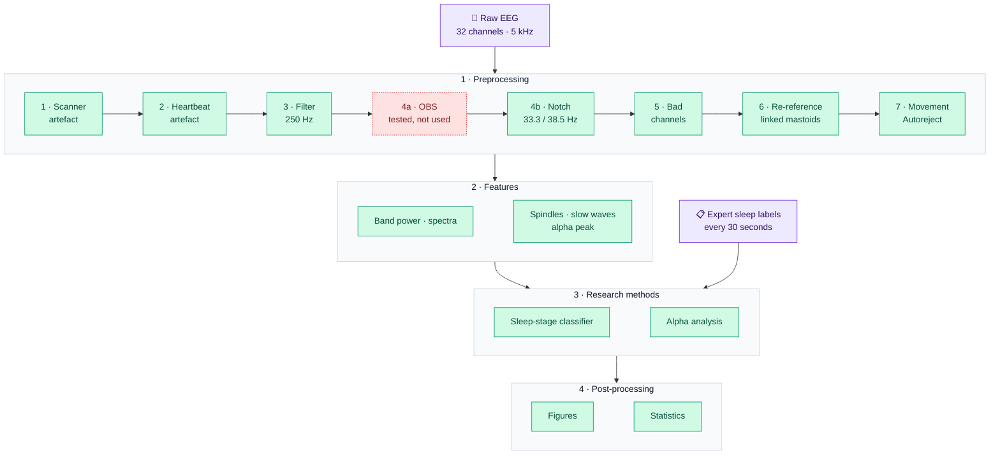

<picture>
  <source media="(prefers-color-scheme: dark)" srcset="assets/banner-dark.svg">
  
</picture>

<p align="center">
  <a href="https://github.com/besrabhagyashree/sleep-eeg-fmri/actions/workflows/tests.yml"></a>
  <a href="#-studies"></a>
  
  
  
  
  
  <a href="https://orcid.org/0009-0008-6118-7602"></a>
  <a href="LICENSE"></a>
</p>

Research on sleep and wakefulness using **EEG recorded simultaneously with fMRI**. Inside a working MRI scanner, the EEG is buried under artefacts hundreds of times larger than brain activity (top trace above). This project builds a pipeline that cleans it, measures it and models it, then uses that pipeline to answer research questions as separate studies.

**Author:** Bhagyashree Besra · ORCID [https://orcid.org/0009-0008-6118-7602](https://orcid.org/0009-0008-6118-7602) · [portfolio](https://besrabhagyashree.github.io) · started October 2026

## 👋 The project in 60 seconds

**Question.** EEG recorded inside an MRI scanner is buried under scanner and heartbeat artefacts. Does cleaning it matter for reading sleep from it, and what goes wrong if you skip it?

**What was built.** A tested, end-to-end pipeline (artefact removal, quality control with standard tools, spectral and sleep-event features, leave-one-person-out classifiers) and five pre-registered studies on public data.

**Key findings**
- **Cleaning did not significantly improve automated sleep staging overall** (Δκ = 0.056, 95% CI [−0.020, 0.137]); reported as an inconclusive result, not hidden.
- **Without cleaning, the classifier's predictions followed heart rate** within expert stages (exploratory, gradient boosting: p = 0.0007, Bonferroni-adjusted p = 0.007; logistic regression p = 0.064), consistent with it partly reading the heartbeat rather than the brain.
- **Slow-wave detection needed cleaning to be usable** (exploratory): almost no events in raw data, and events in 74% of wake epochs after filtering alone. After cleaning it was better but not fully specific (47–52% of wake epochs).
- **A widely used correction method (OBS) removed 75% of slow-wave (delta) power** in participant 1, even away from heartbeats, so it was not used: a caution for sleep EEG-fMRI.
- **Now running:** [study 04](studies/04-multisite-replication), a pre-registered replication of the cleaning, heartbeat and slow-wave findings in independent NIH data (raw, 16 people), with Geneva data (cleaned only, 18 people) for slow-wave validity.

**How.** Plans pre-registered before results, dated amendments, corrections logs, an independent audit script, 56 automated tests in continuous integration, and every reference verified against Crossref.

**Skills shown.** Python · MNE-Python · EEG signal processing and artefact removal · machine-learning evaluation · non-parametric statistics · reproducible research.

### My role and tools

I set the research questions and the rules the work follows: pre-registration before results, only published methods, and reporting null results as they are. I chose the datasets, and I reviewed and approved each pre-registration, analysis decision and correction. The code, analyses and write-ups were produced with an AI coding assistant (Claude Code, Anthropic) working under my direction. Every decision and change is recorded in the dated pre-registrations and corrections logs.

## ✨ At a glance

| | Uncleaned | Cleaned |
|---|:---:|:---:|
| 💓 Heartbeat artefact (O1, average of 1,229 beats) | 86 µV | **4 µV** |
| 🌙 Sleep-spindle band power (12–16 Hz) | 23.5 µV²/Hz | **7.1 µV²/Hz** · 3.3× lower |
| 📡 Beta band power, mostly scanner noise (16–30 Hz) | 81.6 µV²/Hz | **1.3 µV²/Hz** · 62× lower |

<sub>Participant 1, 15-minute sleep recording. Heartbeat row: channel O1; band-power rows: mean of 30 scalp channels.</sub>

**Study 01 results** (29 participants, pre-registered, independently audited; [details](studies/01-preprocessing-ablation#-results)):

| Question | Answer |
|---|---|
| Does artefact correction improve automated sleep staging? | Not significantly on the primary outcome: Δκ = 0.056, 95% CI [−0.020, 0.137], p = 0.33 |
| Does it change what the classifier relies on? | Yes: on uncorrected data, predictions followed heart rate within expert stages (p = 0.0007); after correction this was weak and non-significant |
| Can standard sleep-event detectors be used without it? | No: a slow-wave detector found almost no events in uncorrected data and frequent false events in wake after filtering alone. After correction it was better but not fully specific, and spindle detection without the hypnogram showed no physiological pattern in any arm |
| Who benefits most? | Participants who slept (post hoc, n = 14): Δκ = 0.10–0.18, improved in 10–12 of 14 |

## 🧭 Pipeline



<p align="center">
  
  
  
  
</p>

| Stage | Folder | What it does | Status |
|---|---|---|---|
| 🧹 **1. Preprocessing** | [`src/preprocessing`](src/preprocessing) | Scanner and heartbeat artefact removal, filtering, notch, bad-channel repair, re-reference, movement exclusion; quality checks at every level |   |
| 📊 **2. Features** | [`src/features`](src/features) | Turns each 30-second epoch into band power, spectral shape and eye-movement numbers, plus sleep events (spindles, slow waves, alpha peak) as a second feature set |   |
| 🔬 **3. Research methods** | [`src/methods`](src/methods) | The analyses that answer each question: sleep-stage classification, alpha rhythms |   |
| 📈 **4. Post-processing** | [`src/postprocessing`](src/postprocessing) | Statistics, figures and reports |   |

## 🔬 Studies

| # | Question | Status |
|:---:|---|---|
| [**01**](studies/01-preprocessing-ablation) | **Does preprocessing matter?** The same sleep-staging classifier on raw, filtered-only and fully cleaned EEG, tested on people it never saw | [](studies/01-preprocessing-ablation#-results) |
| [**01b**](studies/01b-n1-classification) | **Improving N1:** do AASM-based features (alpha occupancy, eye movements) or sequence decoding improve classification of the hardest stage? | [](studies/01b-n1-classification#results) |
| [**02**](studies/02-alpha-before-after) | **Alpha before and after learning:** does a person's alpha-rhythm frequency change after a visual-motor task? | [](studies/02-alpha-before-after#results) |
| [**03**](studies/03-run-architecture) | **Sleep across the session:** how do sleep amount, depth and onset change across rest 1, rest 2 and sleep runs 1–3, for the group and for each participant? | [](studies/03-run-architecture#results) |
| [**04**](studies/04-multisite-replication) | **Does it replicate?** Study 01's question in independent raw EEG-fMRI sleep data from NIH (overnight, 16 people), pooled with study 01's 29; Geneva naps (18 people, cleaned only) test slow-wave validity | [](studies/04-multisite-replication#-progress) |

> [!IMPORTANT]
> **Study 01 findings** (29 participants analysed; [full results](studies/01-preprocessing-ablation#-results)):
> - **Primary hypothesis inconclusive.** Artefact correction did not significantly improve per-participant agreement with expert staging (Δκ = 0.056, 95% CI [−0.020, 0.137], p = 0.33). Filtering alone conferred no benefit, and the choice of heartbeat detector made no difference.
> - **Correction removes a cardiac confound** (exploratory). On uncorrected data, classifier predictions covaried with heart rate within expert stages (p = 0.0007); after correction the association was weak and non-significant.
> - **Correction enables valid sleep-event detection** (exploratory). A standard slow-wave detector found almost no events in uncorrected data and frequent events in wake in filtered data; after correction it retained the expected N2 > wake gradient with a threefold lower median wake rate (5.7 vs 2.1 events/min), though 47–52% of wake epochs still had a detection.
> - **Benefit concentrated in participants who slept** (post hoc, n = 14): Δκ = 0.10–0.18, improved in 10–12 of 14; a hypothesis for a prospective study.
> - Pre-registered with 9 dated amendments; all statistics independently recomputed by an audit script.

## 🗂️ Data

[OpenNeuro ds003768](https://openneuro.org/datasets/ds003768/versions/1.0.13): simultaneous EEG and fMRI from 33 healthy adults resting and napping in a 3T scanner, with expert sleep-stage labels for every 30 seconds (Gu et al., 2022, *NeuroImage*; Penn State; CC0 licence). Used in studies 01–03, and pooled with NIH data in study 04 (H2).

| Wake | N1 (drowsy) | N2 (light sleep) | N3 (deep sleep) |
|:---:|:---:|:---:|:---:|
| 3,343 epochs | 2,148 epochs | 1,325 epochs | 42 epochs |

Study 04 adds two independent EEG-fMRI sleep datasets: **[ds005127](https://openneuro.org/datasets/ds005127)**, NIH overnight sleep, 16 participants (Moehlman et al., 2019), and **[ds003574](https://openneuro.org/datasets/ds003574)**, Geneva naps, 18 participants (Sterpenich et al., 2021). Geneva's EEG is available only after the authors' own cleaning, so it is used for slow-wave validity, not for raw-vs-cleaned comparisons.

> [!NOTE]
> No data is stored in this repository. The scripts download it directly from OpenNeuro, one recording at a time.

<p align="center">
  
  <br><sub>Stage 1 on participant 1: raw in-scanner EEG (top), after scanner-artefact removal (middle), after heartbeat removal (bottom).</sub>
</p>

<details>
<summary><b>📁 Repository layout</b></summary>

```
src/
├── preprocessing/    stage 1: artefact removal, filtering
├── features/         stage 2: per-epoch features
├── methods/          stage 3: research methods
└── postprocessing/   stage 4: statistics, figures, this README's banner
studies/
├── 01-preprocessing-ablation/   does cleaning matter for sleep staging?
├── 01b-n1-classification/       can N1 be classified better?
├── 02-alpha-before-after/       alpha rhythm before and after a task
├── 03-run-architecture/         sleep across the runs of a session
└── 04-multisite-replication/    replication in NIH and Geneva data (in progress)
figures/              figures shared across studies
assets/               README banner (drawn from real data by src/postprocessing/readme_banner.py)
```
</details>

<details>
<summary><b>▶️ Reproduce</b></summary>

```bash
python -m venv .venv && .venv/Scripts/pip install -r requirements.txt   # Windows; .venv/bin on Linux/macOS
python src/preprocessing/mr_artifacts.py <recording.vhdr>              # clean one recording, with figures
python src/postprocessing/example_figures.py                           # example figures for participant 1
```

Each study's README gives the commands for that study.
</details>

## 📚 Citation

Gu, Y., Han, F., Sainburg, L. E., Schade, M. M., Buxton, O. M., Duyn, J. H., & Liu, X. (2022). An orderly sequence of autonomic and neural events at transient arousal changes. *NeuroImage*, 264, 119720. [doi:10.1016/j.neuroimage.2022.119720](https://doi.org/10.1016/j.neuroimage.2022.119720). Dataset: OpenNeuro ds003768, [doi:10.18112/openneuro.ds003768.v1.0.0](https://doi.org/10.18112/openneuro.ds003768.v1.0.0).

**Every method, metric, standard and software package used in this project is cited in full, with DOIs, in [REFERENCES.md](REFERENCES.md).**
