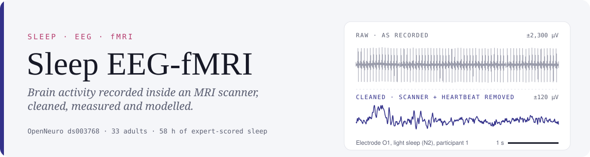
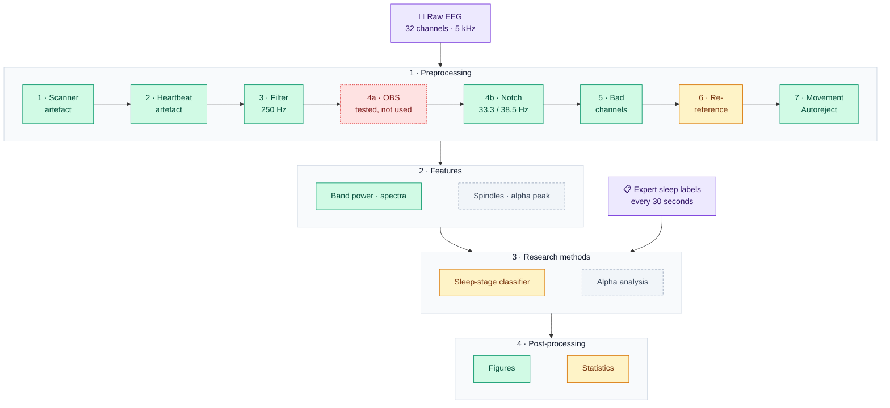
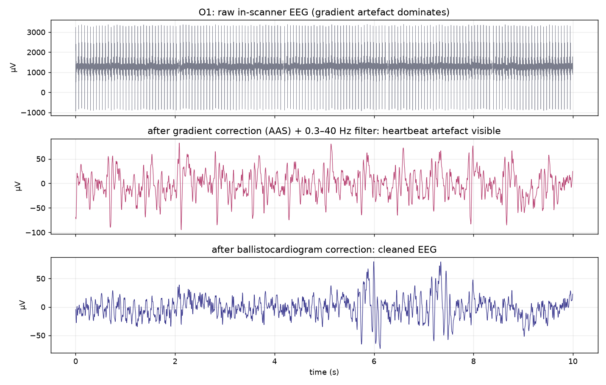

<picture>
  <source media="(prefers-color-scheme: dark)" srcset="assets/banner-dark.svg">
  
</picture>

<p align="center">
  <a href="https://github.com/besrabhagyashree/sleep-eeg-fmri/actions/workflows/tests.yml"></a>
  
  
  
  
  
  
  <a href="https://orcid.org/0009-0008-6118-7602"></a>
  <a href="LICENSE"></a>
</p>

Research on sleep and wakefulness using **EEG recorded simultaneously with fMRI**. Inside a working MRI scanner, the EEG is buried under artefacts hundreds of times larger than brain activity (top trace above). This project builds a pipeline that cleans it, measures it and models it, then uses that pipeline to answer research questions as separate studies.

**Author:** Bhagyashree Besra · [ORCID 0009-0008-6118-7602](https://orcid.org/0009-0008-6118-7602) · [portfolio](https://besrabhagyashree.github.io) · started October 2026

## ✨ At a glance

| | Uncleaned | Cleaned |
|---|:---:|:---:|
| 💓 Heartbeat artefact (O1, average of 1,229 beats) | 86 µV | **4 µV** |
| 🌙 Sleep-spindle band power (12–16 Hz) | 23.5 µV²/Hz | **7.1 µV²/Hz** · 3.3× lower |
| 📡 Beta band power, mostly scanner noise (16–30 Hz) | 81.6 µV²/Hz | **1.3 µV²/Hz** · 62× lower |

<sub>Participant 1, 15-minute sleep recording, mean of 30 scalp channels.</sub>

## 🧭 Pipeline



<p align="center">
  
  
  
  
</p>

| Stage | Folder | What it does | Status |
|---|---|---|---|
| 🧹 **1. Preprocessing** | [`src/preprocessing`](src/preprocessing) | Scanner and heartbeat artefact removal, filtering, notch, bad-channel repair, re-reference, movement exclusion; quality checks at every level |   |
| 📊 **2. Features** | [`src/features`](src/features) | Turns each 30-second epoch into band power, spectral shape and eye-movement numbers |   |
| 🔬 **3. Research methods** | [`src/methods`](src/methods) | The analyses that answer each question: sleep-stage classification, alpha rhythms |  |
| 📈 **4. Post-processing** | [`src/postprocessing`](src/postprocessing) | Statistics, figures and reports |   |

## 🔬 Studies

| # | Question | Status |
|:---:|---|---|
| [**01**](studies/01-preprocessing-ablation) | **Does preprocessing matter?** The same sleep-staging classifier on raw, filtered-only and fully cleaned EEG, tested on people it never saw |  |
| **02** | **Alpha before and after learning:** does a person's alpha-rhythm frequency change after a visual-motor task? |  |

> [!IMPORTANT]
> Study 01's classifier results across all 33 people are being computed now and will be added here when complete, whatever they show.

## 🗂️ Data

[OpenNeuro ds003768](https://openneuro.org/datasets/ds003768/versions/1.0.13): simultaneous EEG and fMRI from 33 healthy adults resting and napping in a 3T scanner, with expert sleep-stage labels for every 30 seconds (Gu et al., 2022, *NeuroImage*; Penn State; CC0 licence).

| Wake | N1 (drowsy) | N2 (light sleep) | N3 (deep sleep) |
|:---:|:---:|:---:|:---:|
| 3,343 epochs | 2,148 epochs | 1,325 epochs | 42 epochs |

> [!NOTE]
> No data is stored in this repository. The scripts download it directly from OpenNeuro, one recording at a time.

<p align="center">
  
  <br><sub>Stage 1 on participant 1: raw in-scanner EEG (top), after scanner-artefact removal (middle), after heartbeat removal (bottom).</sub>
</p>

<details>
<summary><b>📁 Repository layout</b></summary>

```
src/
├── preprocessing/    stage 1: artefact removal, filtering
├── features/         stage 2: per-epoch features
├── methods/          stage 3: research methods
└── postprocessing/   stage 4: statistics, figures, this README's banner
studies/
└── 01-preprocessing-ablation/   question, scripts, results
figures/              figures shared across studies
assets/               README banner (drawn from real data by src/postprocessing/readme_banner.py)
```
</details>

<details>
<summary><b>▶️ Reproduce</b></summary>

```bash
python -m venv .venv && .venv/Scripts/pip install -r requirements.txt   # Windows; .venv/bin on Linux/macOS
python src/preprocessing/mr_artifacts.py <recording.vhdr>              # clean one recording, with figures
python src/postprocessing/example_figures.py                           # example figures for participant 1
```

Each study's README gives the commands for that study.
</details>

## 📚 Citation

Gu, Y., Han, F., Sainburg, L. E., Schade, M. M., Buxton, O. M., Duyn, J. H., & Liu, X. (2022). An orderly sequence of autonomic and neural events at transient arousal changes. *NeuroImage*, 264, 119720. [doi:10.1016/j.neuroimage.2022.119720](https://doi.org/10.1016/j.neuroimage.2022.119720). Dataset: OpenNeuro ds003768, [doi:10.18112/openneuro.ds003768.v1.0.0](https://doi.org/10.18112/openneuro.ds003768.v1.0.0).

**Every method, metric, standard and software package used in this project is cited in full, with DOIs, in [REFERENCES.md](REFERENCES.md).**
