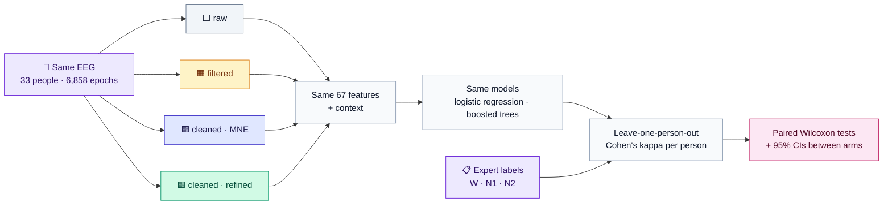

<picture>
  <source media="(prefers-color-scheme: dark)" srcset="assets/banner-dark.svg">
  
</picture>

<p align="center">
  
  
  
  
  
</p>

<p align="center">
  <a href="#-the-question">Question</a> ·
  <a href="#-design">Design</a> ·
  <a href="#-results">Results</a> ·
  <a href="#-all-participants">All participants</a> ·
  <a href="#-methods">Methods</a> ·
  <a href="#-quality-checks">Quality</a> ·
  <a href="#-corrections-log">Corrections</a> ·
  <a href="#%EF%B8%8F-reproduce">Reproduce</a>
</p>

## ❓ The question

EEG recorded during fMRI is buried under scanner and heartbeat artefacts hundreds of times larger than brain activity (top strip in the banner). Labs routinely remove them before analysis. **But how much does that cleaning change what a sleep-staging model can learn, and how much does the choice of heartbeat detector matter?**

This study answers with an **ablation**: the same classifier, trained and tested on the same people and expert labels, using four versions of the same EEG.

| | Arm | EEG used |
|:---:|---|---|
| ⬜ | **raw** | Straight from the dataset: 5 kHz, nothing removed or filtered |
| 🟧 | **filtered** | 0.3–40 Hz filter, 250 Hz, no artefact removal |
| 🟪 | **cleaned (MNE)** | Scanner and heartbeat artefacts removed, then the same filter; heartbeats found by MNE-Python's standard detector, unmodified |
| 🟩 | **cleaned (refined)** | The same, with each detected beat aligned to its ECG peak (one beat per interval) |

## 🧭 Design



Only the EEG differs between arms. Epochs, people, quality exclusions, features, models and tests are identical.

## 📊 Results

> [!IMPORTANT]
> **Primary result: inconclusive.** Removing scanner and heartbeat artefacts did not significantly improve the pre-registered primary outcome (Δκ = +0.056, 95% CI −0.020 to +0.137, p = 0.33). Exploratory analyses suggest the benefit depends on the model and on how much people slept, and that cleaning removes a heart-rate confound. All numbers below were independently recomputed by an audit script (features, kappas, tests, exclusions and counts all matched).

**Sample.** 33 participants built; **29 analysed**, 5,009 epochs per arm (wake 2,541, N1 1,579, N2 889). Excluded by the pre-registered rules: 4 people with more than 25% of epochs rejected by Autoreject (rule 5: participants 03, 13, 17, 31) and 1 recording with more than 3 bad channels (rule 4: participant 07, sleep run 1). Each person is scored by a model trained on the other 28 (leave-one-person-out). Reference for the fully cleaned arm, chosen by the amendment-1 rule before any comparison: **linked mastoids** (median score 0.54 vs 0.26 for the average reference, n = 23).

### Pre-registered hypotheses

Per-person Cohen's kappa against the expert; 3-stage task (W/N1/N2); logistic regression; two-sided Wilcoxon signed-rank; bootstrap 95% CI of the mean difference.

| Hypothesis | Comparison | Mean Δκ | 95% CI | p | Improved / worse | Verdict |
|---|---|:---:|:---:|:---:|:---:|---|
| **H1** (primary) | cleaned (MNE) vs raw | +0.056 | −0.020 to +0.137 | 0.33 | 15 / 13 | **Inconclusive** |
| H2 | filtered vs raw | +0.015 | −0.005 to +0.035 | 0.17 | 15 / 11 | Consistent with H2 (filtering alone does not help) |
| H3 | cleaned (refined) vs cleaned (MNE) | +0.016 | −0.005 to +0.042 | 0.61 | 11 / 16 | No difference between heartbeat detectors |

**Overall agreement** (pooled κ over all epochs; chance ≈ 0):

| Task · model | Raw | Filtered | Cleaned (MNE) | Cleaned (refined) | Fully cleaned (mastoid)\* |
|---|:---:|:---:|:---:|:---:|:---:|
| W/N1/N2 · logistic regression | 0.27 | 0.29 | 0.28 | 0.29 | 0.34 |
| W/N1/N2 · gradient boosting | 0.31 | 0.28 | 0.37 | 0.36 | 0.36 |
| W vs N2 · logistic regression | 0.41 | 0.46 | 0.44 | 0.45 | 0.47 |
| W vs N2 · gradient boosting | 0.41 | 0.31 | **0.56** | 0.55 | 0.53 |

\*Exploratory arm (amendments 1 and 3).

### Secondary tests (exploratory, uncorrected, as pre-registered)

About 30 secondary comparisons were run without correction, so one or two values below 0.05 are expected by chance. The clearest:

| Task · model | Comparison | Mean Δκ | p | Improved / worse |
|---|---|:---:|:---:|:---:|
| W vs N2 · gradient boosting | cleaned (MNE) vs filtered | +0.149 | **0.003** | 17 / 5 |
| W/N1/N2 · gradient boosting | cleaned (MNE) vs filtered | +0.066 | 0.023 | 21 / 7 |
| W vs N2 · gradient boosting | cleaned (MNE) vs raw | +0.100 | 0.050† | 13 / 8 |
| W vs N2 · logistic regression | filtered vs raw | +0.125 | 0.048 | 12 / 8 |
| W vs N2 · logistic regression | cleaned (MNE) vs filtered | **−0.107** | 0.017 | 6 / 16 |

†The default Wilcoxon test drops the 4 people with tied scores; counting them (Pratt or zero-split handling) gives p ≈ 0.07. Not presented as significant.

The two models disagree: cleaning helps gradient boosting clearly, logistic regression hardly at all.

**Signal preservation** (pre-registered, descriptive): posterior alpha is higher in wake than in N2 for **23 of 25** people after cleaning (MNE), 22 of 25 with the refined detector and in the fully cleaned arm, against 20 of 25 raw and 19 of 25 filtered.

**Sensitivity analysis** (pre-registered, per-person feature scaling, `--norm`): every difference shrinks. Primary comparison Δκ = +0.013, p = 0.72; W vs N2 · gradient boosting, cleaned vs raw Δκ = +0.070, p = 0.18. Scaling each person's features around their own median removes much of the between-person stage information, as anticipated in the pre-registration.

### Does leftover heartbeat artefact steer the model? (amendment 5, exploratory)

Within epochs that the expert gave the same stage, a negative Spearman correlation between heart rate and "predicted N2" means slower-heart epochs are called N2 more often, i.e. the model partly reads the heartbeat. Heart rate is a median 3.3 bpm lower in N2 than in wake (slower in N2 for 16 of 25 people).

| Arm | Gradient boosting: median r (people negative) | p | Logistic regression: median r | p |
|---|:---:|:---:|:---:|:---:|
| Raw | **−0.17 (17 of 21)** | **0.0007** | −0.08 | 0.06 |
| Filtered | −0.14 (15 of 20) | 0.024 | −0.09 | 0.13 |
| Cleaned (MNE) | −0.10 (16 of 23) | 0.056 | +0.05 | 0.96 |
| Cleaned (refined) | −0.14 (14 of 22) | 0.11 | +0.02 | 0.89 |
| Fully cleaned (mastoid) | −0.06 (13 of 23) | 0.54 | −0.17 | 0.12 |

On raw and filtered data, gradient boosting's sleep calls follow heart rate (raw p = 0.0007 would survive correction for the 10 tests); after cleaning the link weakens and loses significance. Cleaning removes a confound even where it adds little kappa: part of the raw arm's apparent performance comes from the heartbeat, not the brain.

### Post-hoc: people who slept (amendment 8, added after partial results were seen)

Restricted to the 14 participants who passed every quality rule and were awake for under half their usable epochs (01, 04, 07, 09, 11, 14, 15, 16, 18, 19, 23, 24, 25, 27); leave-one-person-out among the 14; same methods and the same reference.

| Task · model | Comparison | Mean Δκ | 95% CI | p | Improved / worse |
|---|---|:---:|:---:|:---:|:---:|
| W/N1/N2 · logistic regression | cleaned (MNE) vs raw | +0.102 | +0.016 to +0.194 | 0.049 | 10 / 4 |
| W vs N2 · logistic regression | cleaned (MNE) vs raw | +0.179 | +0.061 to +0.310 | 0.009 | 12 / 2 |
| W vs N2 · gradient boosting | cleaned (MNE) vs raw | +0.163 | +0.021 to +0.314 | 0.016 | 12 / 1 |

Pooled κ on the 3-stage task rises from 0.09 (raw) to 0.27 (cleaned). For people who actually slept, cleaning helped consistently. Because the subset was chosen after partial results were seen, tests are uncorrected and n = 14, this is a hypothesis for a prospective study, not a finding that replaces the primary result.

### Sleep-stage transitions in the 14 sleepers (descriptive)


From the expert labels (consecutive 30-s epochs within a recording):

| Pattern | Group | People following it |
|---|---|:---:|
| Falling asleep passes through N1 | 217 of 220 departures from wake go to N1 | 14 / 14 |
| Changes go one step at a time | 95% of stage changes are to a neighbouring stage | 13 / 14 |
| Deeper stages are steadier | chance of staying: W 72%, N1 75%, N2 81%, N3 90% | 10 / 14 (N2 > N1) |
| N1 is a crossroads | from N1: back to wake 12.3%, on to N2 12.3% | 13 / 14 |
| Waking from N2 passes through N1 | N2 → N1 112 times, N2 → wake 28 times | 12 / 14 |

These are the canonical features of normal sleep onset and architecture: entry into sleep through N1, a transitional and easily reversed stage (Carskadon & Dement, 2005; Ogilvie, 2001), and stage-to-stage transition probabilities and bout durations of the kind used to characterise healthy and disordered sleep (Kishi et al., 2008; Bianchi et al., 2010), with wake and sleep bouts following different statistics (Lo et al., 2004). Their presence supports the validity of the expert labels. What is specific to this dataset is fragmentation: most stage bouts last 0.5–1 minute and deep sleep is rare, consistent with reports that people drift in and out of light sleep during fMRI (Tagliazucchi & Laufs, 2014). Note that part of this regularity reflects the scoring rules themselves, which favour continuity.

### Sleep-event feature set (amendment 6)

The secondary comparison with spindles, slow waves and alpha peak added (AASM derivations, amendment 7) is running and will be reported here.

<details>
<summary><b>📈 Per-person kappa by arm, and confusion matrices</b></summary>


</details>

**What cleaning does to the signal** (participant 1, sleep run 1; [`cleaning_effect.py`](cleaning_effect.py)):

| | Uncleaned | Cleaned |
|---|:---:|:---:|
| 💓 Heartbeat artefact (O1, average of 1,229 beats) | 86 µV | **4 µV** |
| 🌙 Sleep-spindle band power (12–16 Hz) | 23.5 µV²/Hz | **7.1 µV²/Hz** · 3.3× lower |
| 📡 Beta band power, mostly scanner noise (16–30 Hz) | 81.6 µV²/Hz | **1.3 µV²/Hz** · 62× lower |

<details>
<summary><b>📈 Power spectrum before and after cleaning</b></summary>


</details>

## 👥 All participants

Updated each time a participant finishes processing, by [`participant_table.py`](participant_table.py). Click a heading to open its table.

<!-- participants-table:start -->
 

**Kappa colours** follow the Landis & Koch (1977) agreement bands: ⬛ ≤ 0 none · 🟥 0.01–0.20 slight · 🟧 0.21–0.40 fair · 🟨 0.41–0.60 moderate · 🟩 0.61–0.80 substantial · 💚 0.81–1.00 almost perfect

<details open>
<summary><b>🎯 Main result: scored by a model trained on all other people</b></summary>

Logistic regression · Cohen's kappa vs the expert · – = not scored (fewer than 3 recordings, or only one stage)

| # | W/N1/N2<br>raw | W/N1/N2<br>filt | W/N1/N2<br>clean-MNE | W/N1/N2<br>clean-ref | W vs N2<br>raw | W vs N2<br>filt | W vs N2<br>clean-MNE | W vs N2<br>clean-ref |
|:---:|:---:|:---:|:---:|:---:|:---:|:---:|:---:|:---:|
| 01 | ⬛ 0.00 | 🟥 0.15 | ⬛ -0.07 | ⬛ -0.11 | ⬛ 0.00 | 🟨 0.58 | 🟥 0.02 | 🟥 0.02 |
| 02 | ⬛ 0.00 | ⬛ 0.00 | 🟨 0.52 | 🟨 0.54 | ⬛ 0.00 | ⬛ 0.00 | ⬛ 0.00 | ⬛ 0.00 |
| 03 | – | – | – | – | – | – | – | – |
| 04 | 🟧 0.35 | 🟧 0.39 | 🟧 0.27 | 🟧 0.25 | 💚 0.86 | 🟩 0.80 | 🟩 0.77 | 🟩 0.79 |
| 05 | 🟥 0.02 | 🟥 0.02 | 🟧 0.29 | 🟧 0.28 | 🟧 0.27 | 🟥 0.20 | ⬛ -0.02 | ⬛ -0.02 |
| 06 | 🟧 0.29 | 🟧 0.29 | 🟧 0.39 | 🟨 0.41 | ⬛ 0.00 | 🟩 0.65 | 🟩 0.67 | 🟩 0.78 |
| 07 | 🟥 0.04 | 🟥 0.14 | 🟧 0.38 | 🟧 0.39 | 🟩 0.66 | 🟥 0.06 | ⬛ -0.02 | 🟩 0.66 |
| 08 | ⬛ 0.00 | ⬛ 0.00 | ⬛ 0.00 | ⬛ 0.00 | – | – | – | – |
| 09 | ⬛ -0.06 | ⬛ 0.00 | 🟧 0.39 | 🟧 0.38 | 🟥 0.04 | 🟩 0.76 | 🟩 0.72 | 🟩 0.80 |
| 10 | 🟥 0.10 | 🟥 0.16 | 🟧 0.29 | 🟧 0.23 | 🟨 0.50 | 🟨 0.47 | 🟨 0.57 | 🟨 0.60 |
| 11 | 🟥 0.14 | 🟥 0.18 | 🟥 0.04 | 🟥 0.14 | 🟥 0.06 | 🟧 0.35 | 🟥 0.11 | 🟧 0.34 |
| 12 | ⬛ -0.11 | ⬛ -0.13 | ⬛ -0.01 | ⬛ -0.02 | ⬛ -0.07 | 🟥 0.08 | ⬛ -0.05 | ⬛ -0.01 |
| 13 | – | – | – | – | – | – | – | – |
| 14 | ⬛ -0.01 | ⬛ 0.00 | ⬛ -0.02 | ⬛ -0.03 | 🟥 0.08 | 🟥 0.17 | ⬛ -0.09 | ⬛ -0.08 |
| 15 | 🟨 0.55 | 🟨 0.59 | 🟧 0.27 | 🟨 0.52 | 🟩 0.70 | 💚 0.93 | 🟧 0.35 | 🟩 0.70 |
| 16 | 🟨 0.55 | 🟨 0.46 | 🟧 0.21 | 🟥 0.17 | ⬛ 0.00 | ⬛ -0.03 | ⬛ -0.03 | ⬛ -0.03 |
| 17 | – | – | – | – | – | – | – | – |
| 18 | 🟥 0.12 | 🟧 0.22 | 🟥 0.01 | 🟥 0.01 | 🟨 0.49 | 🟨 0.49 | 🟨 0.49 | 🟨 0.49 |
| 19 | ⬛ -0.06 | ⬛ -0.07 | 🟥 0.09 | 🟥 0.04 | ⬛ -0.19 | ⬛ -0.19 | 🟥 0.15 | 🟥 0.20 |
| 20 | 🟥 0.01 | 🟥 0.09 | 🟥 0.02 | ⬛ 0.00 | – | – | – | – |
| 21 | 🟥 0.11 | 🟥 0.07 | 🟥 0.16 | 🟥 0.19 | – | – | – | – |
| 22 | 🟥 0.06 | 🟥 0.12 | ⬛ 0.00 | 🟥 0.08 | ⬛ 0.00 | 🟩 0.71 | 🟧 0.24 | 🟧 0.25 |
| 23 | 🟧 0.29 | 🟧 0.31 | 🟧 0.28 | 🟧 0.27 | 🟧 0.22 | 🟧 0.35 | 🟨 0.54 | 🟧 0.40 |
| 24 | ⬛ -0.02 | ⬛ -0.02 | 🟥 0.11 | 🟧 0.25 | ⬛ -0.38 | 🟥 0.03 | 🟥 0.03 | 🟥 0.01 |
| 25 | 🟥 0.13 | 🟥 0.02 | ⬛ 0.00 | ⬛ -0.03 | ⬛ -0.14 | 🟥 0.09 | 🟥 0.09 | ⬛ 0.00 |
| 26 | ⬛ 0.00 | ⬛ 0.00 | 🟨 0.54 | 🟨 0.59 | – | – | – | – |
| 27 | 🟧 0.26 | 🟧 0.25 | 🟥 0.05 | 🟥 0.14 | 🟧 0.37 | 🟨 0.48 | 🟥 0.08 | 🟥 0.14 |
| 28 | 🟩 0.66 | 🟩 0.62 | 🟨 0.50 | 🟨 0.48 | 🟩 0.76 | 🟩 0.74 | 🟨 0.60 | 🟨 0.60 |
| 29 | 🟧 0.31 | 🟧 0.24 | 🟩 0.61 | 🟩 0.67 | 💚 0.92 | 💚 0.87 | 💚 0.87 | 💚 0.87 |
| 30 | 🟥 0.10 | 🟥 0.10 | ⬛ 0.00 | ⬛ 0.00 | 🟨 0.49 | 🟥 0.18 | ⬛ 0.00 | ⬛ 0.00 |
| 31 | – | – | – | – | – | – | – | – |
| 32 | ⬛ -0.01 | ⬛ -0.01 | 🟥 0.04 | 🟥 0.04 | ⬛ 0.00 | ⬛ 0.00 | 🟥 0.03 | 🟥 0.02 |
| 33 | 🟥 0.04 | 🟥 0.10 | 🟥 0.12 | 🟥 0.08 | ⬛ 0.00 | ⬛ 0.00 | ⬛ -0.03 | ⬛ -0.05 |
| **median** | **🟥 0.06** | **🟥 0.10** | **🟥 0.12** | **🟥 0.17** | **🟥 0.06** | **🟧 0.35** | **🟥 0.09** | **🟥 0.20** |

</details>

<details>
<summary><b>🔍 Within-person preview: trained on the person's other recordings</b></summary>

Logistic regression · Cohen's kappa vs the expert · – = not scored (fewer than 3 recordings, or only one stage)

| # | W/N1/N2<br>raw | W/N1/N2<br>filt | W/N1/N2<br>clean-MNE | W/N1/N2<br>clean-ref | W vs N2<br>raw | W vs N2<br>filt | W vs N2<br>clean-MNE | W vs N2<br>clean-ref |
|:---:|:---:|:---:|:---:|:---:|:---:|:---:|:---:|:---:|
| 01 | ⬛ -0.03 | ⬛ -0.06 | ⬛ -0.01 | ⬛ -0.04 | ⬛ -0.11 | 🟥 0.09 | 🟥 0.03 | ⬛ -0.10 |
| 02 | – | – | – | – | – | – | – | – |
| 03 | ⬛ -0.03 | ⬛ -0.11 | ⬛ -0.02 | ⬛ -0.02 | ⬛ -0.02 | ⬛ -0.02 | 🟧 0.39 | 🟧 0.39 |
| 04 | 🟧 0.39 | 🟧 0.30 | 🟨 0.41 | 🟨 0.42 | 💚 0.86 | 💚 0.83 | 💚 0.93 | 💚 0.90 |
| 05 | 🟧 0.31 | 🟧 0.32 | ⬛ -0.01 | ⬛ -0.07 | ⬛ -0.03 | ⬛ -0.03 | ⬛ -0.04 | ⬛ -0.03 |
| 06 | ⬛ -0.10 | 🟥 0.10 | 🟥 0.18 | 🟥 0.09 | ⬛ -0.12 | ⬛ -0.11 | ⬛ -0.11 | ⬛ -0.11 |
| 07 | 🟥 0.16 | 🟥 0.09 | 🟥 0.10 | 🟥 0.09 | ⬛ -0.04 | ⬛ -0.03 | ⬛ -0.04 | ⬛ -0.03 |
| 08 | ⬛ -0.01 | ⬛ -0.01 | ⬛ -0.01 | ⬛ -0.01 | – | – | – | – |
| 09 | 🟧 0.37 | 🟧 0.39 | 🟨 0.48 | 🟨 0.49 | 🟩 0.65 | 🟩 0.67 | 💚 0.89 | 💚 0.91 |
| 10 | 🟥 0.17 | 🟧 0.24 | 🟧 0.39 | 🟧 0.40 | 🟧 0.30 | 🟧 0.40 | 🟨 0.44 | 🟨 0.50 |
| 11 | 🟧 0.31 | 🟧 0.28 | 🟥 0.16 | 🟥 0.13 | ⬛ -0.11 | ⬛ -0.11 | 🟧 0.29 | 🟧 0.29 |
| 12 | 🟥 0.14 | 🟧 0.34 | ⬛ -0.54 | ⬛ -0.47 | ⬛ -0.15 | ⬛ -0.16 | ⬛ -0.22 | ⬛ -0.24 |
| 13 | ⬛ -0.04 | ⬛ 0.00 | 🟥 0.11 | 🟥 0.06 | ⬛ -0.16 | ⬛ -0.15 | ⬛ -0.14 | ⬛ -0.12 |
| 14 | 🟥 0.01 | 🟥 0.03 | 🟥 0.18 | 🟥 0.19 | 🟨 0.43 | 🟨 0.51 | 🟩 0.61 | 🟩 0.69 |
| 15 | 🟨 0.45 | 🟨 0.47 | 🟨 0.52 | 🟨 0.56 | 💚 0.96 | 💚 0.96 | 💚 0.98 | 💚 0.98 |
| 16 | ⬛ -0.01 | 🟥 0.10 | ⬛ -0.04 | 🟥 0.17 | 🟥 0.14 | 🟩 0.66 | ⬛ -0.03 | 🟥 0.11 |
| 17 | 🟥 0.16 | 🟥 0.19 | ⬛ -0.07 | 🟥 0.13 | ⬛ -0.08 | ⬛ -0.11 | ⬛ -0.07 | ⬛ -0.08 |
| 18 | 🟧 0.22 | 🟧 0.25 | 🟧 0.34 | 🟧 0.36 | 🟥 0.09 | ⬛ -0.09 | 🟧 0.37 | 🟧 0.37 |
| 19 | 🟥 0.13 | 🟥 0.07 | ⬛ -0.09 | ⬛ -0.01 | 🟥 0.11 | 🟥 0.16 | ⬛ -0.13 | ⬛ -0.10 |
| 20 | 🟥 0.15 | 🟧 0.22 | 🟥 0.06 | 🟥 0.06 | – | – | – | – |
| 21 | – | – | – | – | – | – | – | – |
| 22 | 🟧 0.21 | 🟧 0.40 | 🟥 0.20 | 🟧 0.25 | 💚 0.96 | 💚 0.91 | 💚 0.92 | 💚 0.96 |
| 23 | ⬛ -0.22 | 🟥 0.03 | 🟥 0.04 | 🟥 0.08 | ⬛ -0.06 | 🟧 0.21 | 🟧 0.26 | 🟧 0.24 |
| 24 | 🟥 0.04 | ⬛ -0.03 | 🟥 0.09 | 🟥 0.06 | 🟥 0.19 | 🟥 0.15 | 🟧 0.38 | 🟥 0.03 |
| 25 | 🟥 0.11 | 🟥 0.16 | 🟥 0.05 | ⬛ -0.02 | ⬛ 0.00 | ⬛ 0.00 | ⬛ 0.00 | ⬛ 0.00 |
| 26 | 🟥 0.18 | 🟥 0.18 | 🟧 0.34 | 🟧 0.21 | – | – | – | – |
| 27 | 🟨 0.42 | 🟧 0.33 | 🟨 0.48 | 🟨 0.53 | 🟩 0.77 | 🟩 0.77 | 🟩 0.74 | 🟩 0.70 |
| 28 | 🟨 0.45 | 🟧 0.40 | 🟧 0.29 | 🟧 0.31 | 🟨 0.54 | 🟨 0.54 | 🟨 0.49 | 🟨 0.53 |
| 29 | 🟧 0.37 | 🟧 0.35 | 🟨 0.42 | 🟨 0.52 | ⬛ -0.02 | ⬛ -0.01 | ⬛ 0.00 | ⬛ 0.00 |
| 30 | 🟥 0.14 | 🟥 0.12 | ⬛ -0.03 | 🟥 0.01 | 🟩 0.64 | 🟥 0.20 | 🟨 0.59 | 🟨 0.56 |
| 31 | ⬛ -0.01 | 🟥 0.07 | 🟧 0.34 | 🟥 0.02 | ⬛ -0.10 | 🟧 0.29 | 🟥 0.11 | ⬛ -0.05 |
| 32 | ⬛ -0.14 | ⬛ -0.18 | ⬛ -0.12 | ⬛ -0.08 | ⬛ -0.14 | ⬛ -0.14 | ⬛ -0.12 | 🟥 0.03 |
| 33 | 🟧 0.29 | 🟧 0.34 | 🟧 0.26 | 🟧 0.21 | ⬛ -0.05 | ⬛ -0.04 | ⬛ -0.02 | ⬛ -0.02 |
| **median** | **🟥 0.15** | **🟥 0.18** | **🟥 0.11** | **🟥 0.09** | **⬛ -0.01** | **🟥 0.12** | **🟥 0.18** | **🟥 0.07** |

</details>

<details>
<summary><b>🩺 Data quality per participant</b></summary>

✅/❌ against the pre-set conventions: ≤ 3 bad channels (PREP) per recording; ≤ 25% of epochs flagged (Autoreject). INPS has no published threshold, so it is shown without a colour.

| # | Status | Recordings | Epochs kept<br>(W / N1 / N2) | Flagged | Expert-<br>unscorable | Bad channels<br>(max) | INPS dB<br>MNE / refined | Double-counted beats<br>MNE / refined |
|:---:|:---:|:---:|:---:|:---:|:---:|:---:|:---:|:---:|
| 01 | ✅ ok | 5 | 118 (38 / 46 / 34) | ✅ 9.2% | 0 | ✅ 1 | 0.99 / 1.51 | 336 / 0 |
| 02 | ✅ ok | 2 | 38 (27 / 7 / 4) | ✅ 5.0% | 0 | ✅ 1 | 1.73 / 1.67 | 122 / 0 |
| 03 | ❌ excluded (> 25% epochs flagged) | 10 | 206 (2 / 38 / 166) | ❌ 26.2% | 1 | ✅ 2 | 2.13 / 2.41 | 246 / 0 |
| 04 | ✅ ok | 9 | 221 (89 / 87 / 45) | ✅ 11.6% | 0 | ✅ 1 | 1.61 / 1.49 | 1411 / 0 |
| 05 | ✅ ok | 8 | 195 (172 / 19 / 4) | ✅ 11.4% | 0 | ✅ 1 | 1.52 / 1.59 | 555 / 0 |
| 06 | ✅ ok | 6 | 131 (108 / 13 / 10) | ✅ 18.1% | 0 | ✅ 2 | 2.44 / 2.75 | 16 / 0 |
| 07 | ✅ ok | 7 | 120 (2 / 58 / 60) | ✅ 14.9% | 22 | ❌ 4 | 0.69 / 0.73 | 197 / 0 |
| 08 | ✅ ok | 9 | 210 (208 / 2 / 0) | ✅ 15.0% | 3 | ✅ 1 | 1.33 / 1.52 | 383 / 0 |
| 09 | ✅ ok | 8 | 180 (54 / 72 / 54) | ✅ 17.4% | 2 | ✅ 1 | 3.58 / 3.95 | 144 / 0 |
| 10 | ✅ ok | 8 | 189 (107 / 40 / 42) | ✅ 14.1% | 0 | ✅ 1 | 2.89 / 2.34 | 65 / 0 |
| 11 | ✅ ok | 8 | 146 (48 / 95 / 3) | ✅ 24.4% | 27 | ✅ 1 | 0.67 / 1.09 | 790 / 0 |
| 12 | ✅ ok | 5 | 99 (61 / 29 / 9) | ✅ 23.8% | 0 | ✅ 1 | 3.24 / 3.50 | 64 / 0 |
| 13 | ❌ excluded (> 25% epochs flagged) | 6 | 108 (86 / 9 / 13) | ❌ 32.5% | 0 | ✅ 2 | 0.82 / 0.96 | 272 / 0 |
| 14 | ✅ ok | 9 | 218 (28 / 173 / 17) | ✅ 12.8% | 0 | ✅ 1 | 0.73 / 0.66 | 909 / 27 |
| 15 | ✅ ok | 8 | 196 (58 / 85 / 53) | ✅ 10.9% | 0 | ✅ 1 | 1.94 / 2.35 | 437 / 0 |
| 16 | ✅ ok | 10 | 168 (2 / 51 / 115) | ✅ 16.4% | 0 | ✅ 1 | 0.45 / 0.32 | 1448 / 0 |
| 17 | ❌ excluded (> 25% epochs flagged) | 9 | 185 (118 / 58 / 9) | ❌ 25.7% | 1 | ✅ 1 | 3.22 / 4.03 | 548 / 1 |
| 18 | ✅ ok | 7 | 147 (49 / 95 / 3) | ✅ 22.6% | 0 | ✅ 1 | 0.67 / 0.78 | 621 / 0 |
| 19 | ✅ ok | 7 | 144 (31 / 56 / 57) | ✅ 24.2% | 0 | ✅ 2 | 1.14 / 1.17 | 434 / 0 |
| 20 | ✅ ok | 7 | 155 (101 / 54 / 0) | ✅ 17.6% | 2 | ✅ 2 | 3.06 / 3.17 | 19 / 0 |
| 21 | ✅ ok | 2 | 36 (22 / 14 / 0) | ✅ 10.0% | 0 | ✅ 1 | 1.69 / 1.84 | 114 / 0 |
| 22 | ✅ ok | 10 | 263 (144 / 106 / 13) | ✅ 6.1% | 0 | ✅ 1 | 1.25 / 2.61 | 805 / 0 |
| 23 | ✅ ok | 10 | 206 (50 / 49 / 107) | ✅ 8.8% | 54 | ✅ 2 | 1.17 / 1.39 | 864 / 32 |
| 24 | ✅ ok | 8 | 193 (96 / 46 / 51) | ✅ 12.3% | 0 | ✅ 0 | 1.50 / 2.74 | 2069 / 64 |
| 25 | ✅ ok | 8 | 208 (63 / 128 / 17) | ✅ 5.5% | 0 | ✅ 2 | 4.47 / 5.61 | 102 / 0 |
| 26 | ✅ ok | 8 | 175 (168 / 7 / 0) | ✅ 20.5% | 0 | ✅ 3 | 2.28 / 3.64 | 278 / 0 |
| 27 | ✅ ok | 9 | 207 (51 / 75 / 81) | ✅ 16.5% | 2 | ✅ 1 | 1.36 / 1.55 | 1251 / 58 |
| 28 | ✅ ok | 8 | 200 (117 / 19 / 64) | ✅ 7.0% | 5 | ✅ 3 | 1.51 / 1.76 | 120 / 0 |
| 29 | ✅ ok | 9 | 222 (203 / 12 / 7) | ✅ 11.2% | 0 | ✅ 2 | 2.02 / 2.86 | 764 / 153 |
| 30 | ✅ ok | 8 | 184 (96 / 72 / 16) | ✅ 15.6% | 2 | ✅ 2 | 4.95 / 5.10 | 11 / 0 |
| 31 | ❌ excluded (> 25% epochs flagged) | 8 | 138 (9 / 72 / 57) | ❌ 37.3% | 0 | ✅ 0 | 0.41 / 0.64 | 826 / 0 |
| 32 | ✅ ok | 10 | 236 (198 / 21 / 17) | ✅ 12.6% | 10 | ✅ 1 | 0.71 / 0.78 | 1837 / 445 |
| 33 | ✅ ok | 9 | 204 (150 / 48 / 6) | ✅ 18.4% | 0 | ✅ 1 | 1.07 / 0.91 | 754 / 0 |

</details>
<!-- participants-table:end -->

<details>
<summary><b>🔎 Participant 1 in detail (preview, not the study result)</b></summary>

Trained on 4 of participant 1's recordings and tested on the fifth, rotating through all five ([`score_one_person.py`](score_one_person.py)). 118 epochs kept (wake 38, N1 46, N2 34; 12 flagged by Autoreject). Full tables: [`results/preview_sub-01_scores.csv`](results/preview_sub-01_scores.csv), [`results/preview_sub-01_quality.csv`](results/preview_sub-01_quality.csv).

| Task | Model | Raw | Filtered | Cleaned (MNE) | Cleaned (refined) |
|---|---|:---:|:---:|:---:|:---:|
| Wake / N1 / N2 | Logistic regression | −0.03 | −0.06 | −0.01 | −0.04 |
| Wake / N1 / N2 | Gradient boosting | 0.10 | −0.08 | 0.01 | −0.11 |
| Wake vs N2 | Logistic regression | −0.11 | 0.09 | 0.03 | −0.10 |
| Wake vs N2 | Gradient boosting | 0.12 | −0.04 | 0.03 | 0.23 |

| Recording | INPS MNE (double counts) | INPS refined (double counts) | Bad channels | Epochs flagged |
|---|:---:|:---:|:---:|:---:|
| Rest 1 | 1.63 dB (54) | 1.37 dB (0) | Fp2 | 2 of 20 |
| Rest 2 | 0.10 dB (8) | 0.05 dB (0) | – | 3 of 20 |
| Sleep 1 | 0.99 dB (87) | 1.69 dB (0) | – | 5 of 30 |
| Sleep 2 | 1.34 dB (122) | 2.10 dB (0) | – | 1 of 30 |
| Sleep 3 | 0.88 dB (65) | 1.51 dB (0) | F8 | 1 of 30 |

Within participant 1 every arm stays near chance and the order of the arms changes between rows, so one person cannot separate them: about 90 training epochs for 134 features, very different stage mixes between recordings, and a hard case (in an earlier code test, wake vs N2 stayed at chance for them in both raw and cleaned data). The refined detector removed more heartbeat artefact in all three sleep recordings and never double-counted. In rest 2 both removed almost nothing and disagree on the heart rate (65 vs 80 bpm): that recording's ECG needs investigating.
</details>

## 🔬 Methods

<details>
<summary><b>Data</b></summary>

All 33 participants of [OpenNeuro ds003768](https://openneuro.org/datasets/ds003768/versions/1.0.13): 6,858 cleanly labelled 30-second epochs (wake 3,343, N1 2,148, N2 1,325, N3 42). N3 is too rare to model and is merged with N2. Epochs the dataset's expert scorer marked **uncertain or unscorable** (1.9%) are left out, using the study's own flags.
</details>

<details>
<summary><b>Pipeline, step by step</b></summary>

Only established EEG methods and the dataset's own information are used for cleaning and scoring.

1. **Scanner artefact:** average artefact subtraction locked to the R128 volume triggers, 21-volume sliding template (Allen, Josephs & Turner, 2000, *NeuroImage*).
2. **Heartbeat artefact:** average artefact subtraction locked to each heartbeat, 21-beat template (Allen et al., 1998, *NeuroImage*). Two detectors, compared as arms: MNE-Python's `find_ecg_events` (Gramfort et al., 2013), unmodified; and the same with timing refinement (beat placed at the 8–25 Hz ECG energy peak, at most one per 0.6 beat intervals). The refinement is this study's documented adaptation, not a published detector. Removal is skipped if the heart rate is outside 40–120 bpm (logged).
3. **Filter and resample:** 0.3–40 Hz, 250 Hz.
4. **Features (identical for every arm):** following common sleep-staging practice (e.g. Vallat & Walker, 2021), per 30-second epoch and per region (frontal, central, posterior, temporal): log and relative power in delta, theta, alpha, sigma and beta from Welch spectra (Welch, 1967), 95% spectral edge, theta/alpha ratio, Hjorth mobility and complexity (Hjorth, 1970); slow and fast eye-channel power. 67 features, plus a ±2-epoch context average. The ECG channel is never used as a feature.
5. **Quality checks and exclusions:** see below. Judged on the standard-cleaned (MNE) recording and applied identically to every arm.
6. **Tasks and models:** wake / N1 / N2 and wake vs N2; logistic regression on standardised features and gradient-boosted trees (Friedman, 2001), both with balanced class weights, in scikit-learn (Pedregosa et al., 2011). **Leave-one-person-out** cross-validation.
7. **Statistics:** Cohen's kappa (Cohen, 1960) against the expert for each person, coloured by the Landis & Koch (1977) bands; arms compared with paired Wilcoxon signed-rank tests (Wilcoxon, 1945) and bootstrap 95% confidence intervals (Efron, 1979) of the mean difference; a stratified-chance classifier gives the floor.
</details>

## 🩺 Quality checks

Every recording is checked at four levels ([`src/preprocessing/quality.py`](../../src/preprocessing/quality.py); summary by [`src/postprocessing/quality_report.py`](../../src/postprocessing/quality_report.py)):

| Level | What is checked | Method | Used for |
|---|---|---|---|
| 📁 **Files** | Size and MD5 checksum against OpenNeuro; 32 channels, ECG and EOG, regular scanner triggers; agreement with the dataset's BIDS metadata | Checksums; BIDS sidecar files | ✅/❌ |
| 🔌 **Channels** | Flat, abnormal-amplitude, poorly correlated and unpredictable channels | **PREP** (Bigdely-Shamlo et al., 2015) via PyPREP; its high-frequency criterion is not used (data low-passed at 40 Hz) | Recording excluded if > 3 of 30 channels are bad (10%, a common convention) |
| 🧩 **Epochs** | Peak-to-peak amplitude above a threshold learned from the recording | **Autoreject** global threshold (Jas et al., 2017) on the labelled 30-s epochs | Epoch excluded; person excluded if > 25% flagged (a common convention) |
| 💓 **Correction** | Heartbeat removal: **INPS**, power in 1-Hz windows at the first five heart-rate harmonics before vs after, in dB (Tong et al., 2001). Scanner removal: residual peak at the slice frequency and its harmonic | Published metrics | Reported; no pass/fail, because no published threshold exists |

Signal preservation uses the dataset's own labels: for each person, posterior alpha should be higher in wake than in N2, following evaluations that check a known physiological contrast survives cleaning (Abreu et al., 2016; Gallego-Rudolf et al., 2022). Reported for every arm.

> [!WARNING]
> **Metadata mismatch:** the dataset's BIDS metadata says the EEG is sampled at 250 Hz, but every file header and the data are 5,000 Hz. Recorded as an integrity finding; the files are used as they are.

> [!NOTE]
> **General-purpose ECG detectors fail on in-scanner ECG** ([`compare_qrs_detectors.py`](compare_qrs_detectors.py)). NeuroKit2's (Makowski et al., 2021) implementations of published clinical detectors (Pan & Tompkins, 1985; Hamilton, 2002; Elgendi et al., 2010; Engelse & Zeelenberg, 1979 modified by Lourenço et al., 2012; Christov, 2004) and a Teager-energy detector (Kim et al., 2004) reported 110–254 bpm or missed or double-counted hundreds of beats on participants 1 and 4. MNE's detector found the right rate (82 and 66 bpm) but double-counted 87 and 155 beats (7–14%); the refined version counted none double. The recording reference is FCz (from the metadata), which is why Fz and Cz look nearly flat.

<details>
<summary><b>🧪 Exploratory diagnostics (not used for scoring)</b></summary>

These use this study's own tests rather than established metrics, so they inform the method but never decide inclusion or results.

- [`data_accounting.py`](data_accounting.py): share of signal each step removes on participant 1: gradient subtraction 99.68% of raw power; the 0.3–40 Hz filter 12.8% of the rest (10.5% below 0.3 Hz, 2.3% above 40 Hz); heartbeat subtraction 19.9% (sigma band 57%); cropping 3.5% of recording time.
- [`overcorrection_check.py`](overcorrection_check.py): the same heartbeat subtraction at heartbeat-like times not locked to the heart removes 3.3–5.1% of band power, close to the method's theoretical 1/21 (4.8%), against 22–57% at real heartbeats.
- [`validate_obs.py`](validate_obs.py): optimal basis sets (4 components) raise heartbeat removal (INPS 6.79 vs 1.69 dB) but remove 69.6% of 0.5–30 Hz power; at times not locked to the heart they still remove 75% of delta and 32% of theta, against 4–5% for average subtraction. Sleep slow waves last about one heartbeat and are absorbed into the basis, so OBS is not used.
- [`obs_one_person.py`](obs_one_person.py) (amendment 4, exploratory): participant 1 rebuilt with OBS and scored like the other arms ([`results/obs_staging_sub-01.csv`](results/obs_staging_sub-01.csv)). OBS removed 2–5× more heartbeat artefact in every recording (INPS 1.7–6.8 dB vs 0.1–2.1 dB), but staging did not improve. Wake vs N2 was below chance for both OBS arms (kappa −0.17 to −0.10), and no arm beats chance reliably for this person (about 70–120 epochs; kappa standard error ≈ 0.1). No evidence that OBS helps; the amendment-2 decision stands.
- [`validate_stages.py`](validate_stages.py): notch, spline interpolation and re-reference steps on participant 1 (pre-registration amendment 1).
- [`signal_preservation.py`](signal_preservation.py): the cleaned spectrum keeps the shape of the 24 s recorded before scanning between 0.5 and 15 Hz. That stretch already contains unmarked scanner warm-up (16.7 Hz), so it is an imperfect reference. A 38.5 Hz peak is present before scanning too (scanner-room equipment), and 3 and 6 Hz peaks appear only during scanning.


</details>

## 📝 Corrections log

<details>
<summary><b>Every fix and every change to the plan, dated (all before any 33-person results)</b></summary>

- **In-place filtering bug (fixed 22 Oct 2026).** MNE's `RawArray` does not copy its input and `filter()` works in place, so building the *filtered* arm altered the data the *cleaned* arm was built from. Fixed with explicit copies. Participant 1's headline numbers barely moved (sigma 7.2 → 7.1 µV²/Hz; ratios unchanged), but all features are rebuilt.
- **Heartbeat double counting (fixed).** The first detector counted T-waves as beats in some recordings (participant 4: 106 bpm instead of 66).
- **Custom quality rules replaced (22 Oct 2026).** The first version used this study's own tests (random-timing residual, surrogate brain loss, a 2-of-3-window epoch rule). They were replaced by established methods (INPS, standard Autoreject, PREP) and the dataset's own labels, after quality checks on a few recordings of participants 1–4 and before any classification results.
- **Analysis plan revised before results.** After a code test on 4–5 people, logistic regression and the wake-vs-N2 task were added and per-person feature scaling moved to a sensitivity analysis (`--norm`), because people's stage mixes differ hugely (one is 96% wake, another 76% N2).
- **Two dataset file problems (handled 22 Oct 2026).** sub-16 sleep run 1 has no `.eeg` data file on OpenNeuro (header and markers only); the build crashed on the missing download and now skips such runs, logged as "file missing from dataset". sub-16 rest run 1's header names its data file `rsub-16_…` (a typo); the local copy of the header is pointed at the real file and the fix is recorded in the quality table (`header_datafile_fixed`); the data file itself is unchanged and its MD5 is still checked.
- **Label-file typo (handled 22 Oct 2026, before sub-32 was built).** In `sub-32-sleep-stage.tsv`, line 69 (sleep run 1, 810 s) separates the time and the stage with a space instead of a tab. The reader now accepts that one pattern; all other 32 label files were checked to parse identically.
- **Event channels (fixed 22 Oct 2026, before any event-set results).** The right mastoid (TP10) is bad in 40 of the first 149 recordings, and event detection had used it for the left-hemisphere derivations. Events now use the AASM recommended derivations (F4–M1, C4–M1, O2–M1), with the backups only when a recommended electrode is bad (amendment 7); all event features are recomputed.
- **Recordings with no scorable epochs (handled 22 Oct 2026).** Every epoch of sub-23 rest run 1 is marked "W (uncertain)" by the expert, so after the uncertain epochs are dropped nothing is left, and the quality step crashed on an empty recording. Such recordings are now skipped and logged as "no expert-scored epochs" (after the checksum and header checks); no data changes.
</details>

> [!TIP]
> The analysis plan, exclusions and tests are fixed in [PREREGISTRATION.md](PREREGISTRATION.md), written before the full results.

## 📚 References

Full citations with DOIs for every method, metric, dataset and software package: **[REFERENCES.md](../../REFERENCES.md)**. Optimal basis sets (Niazy et al., 2005) were tested and not adopted: on participant 1 they removed 75% of delta power even at times not locked to the heart ([`validate_obs.py`](validate_obs.py); pre-registration amendment 2).

## ⚠️ Limitations

- Narrow residual artefact peaks remain after cleaning (20–48 Hz; see the spectrum).
- The artefact templates include the current volume or heartbeat, which subtracts about 1/21 (5%) of that segment's own brain signal.
- Cleaning removes any brain response genuinely locked to the heartbeat (heartbeat-evoked potentials, a few µV); irrelevant for sleep staging, relevant for body–brain research.
- Naps in a scanner contain almost no deep sleep, and only 16 of 33 people have 10 or more minutes of N2.
- 33 people is a small sample; results are reported per person with confidence intervals, not only as one pooled number.

## ▶️ Reproduce

<details>
<summary><b>Commands</b></summary>

```bash
python studies/01-preprocessing-ablation/build_dataset.py     # download, clean (4 arms), quality-check, extract features (~10 h)
python src/postprocessing/quality_report.py studies/01-preprocessing-ablation/results   # quality tables + figure
python studies/01-preprocessing-ablation/compare_arms.py      # leave-one-person-out comparison -> results/
python studies/01-preprocessing-ablation/participant_table.py # the all-participants tables in this README
python src/postprocessing/study01_banner.py                   # this README's banner, from real data
python studies/01-preprocessing-ablation/compare_qrs_detectors.py <recording.vhdr> [...]
```
</details>
