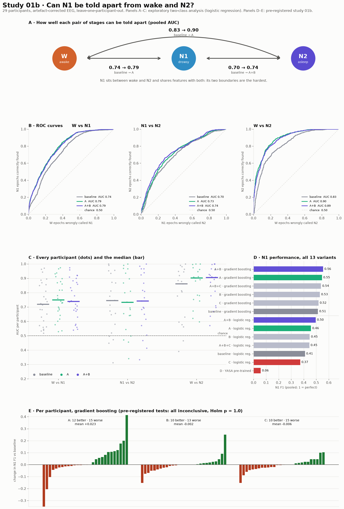

# Study 01b · Improving classification of N1

**Question.** Do features and decoding that follow AASM scoring principles improve automatic classification of stage N1 in in-scanner EEG? Pre-registered in [PREREGISTRATION.md](PREREGISTRATION.md) before any analysis was run.

**Data.** The 29 participants analysed in [study 01](../01-preprocessing-ablation), artefact-corrected (AAS-MNE) EEG, the same 5,009 epochs (W 2,541, N1 1,579, N2 889) and exclusions. Leave-one-participant-out validation. Primary outcome: per-participant N1 F1 in the 28 participants with at least 5 N1 and 5 non-N1 epochs.

| Method | What it adds |
|---|---|
| Baseline | Study 01 classifier: 67 spectral features plus ±2-epoch averages |
| **A** | AASM alpha rule: fraction of 2-s windows with an alpha peak above theta (O2–M1), and the median alpha/theta ratio |
| **B** | Eye movements: slow (0.3–1 Hz) and fast (1–5 Hz) EOG power, their ratio, slow-component amplitude |
| **C** | Hidden Markov decoding (Rabiner, 1989): transitions learned from training participants, Viterbi path per recording |
| **D** | YASA pre-trained sleep stager (Vallat & Walker, 2021), not trained on this dataset (benchmark) |

## Results

> [!IMPORTANT]
> **No method significantly improved per-participant N1 classification.** All three pre-registered hypotheses were inconclusive (Holm-adjusted p = 1.0). The AASM alpha rule (A) was the only method that shifted N1, wake and overall agreement in the favourable direction with both classifiers, but its per-participant gain was small and not significant. HMM decoding reduced N1 performance with logistic regression, and a pre-trained stager did not transfer to in-scanner EEG.

### Pre-registered tests (gradient boosting, n = 28)

| Hypothesis | Δ N1 F1 [95% CI] | Better / worse | p | Holm p | Conclusion |
|---|:---:|:---:|:---:|:---:|---|
| H-A, alpha occupancy | 0.023 [−0.027, 0.073] | 12 / 15 | 0.36 | 1.0 | Inconclusive |
| H-B, eye movements | −0.002 [−0.024, 0.024] | 10 / 13 | 0.48 | 1.0 | Inconclusive |
| H-C, HMM decoding | −0.006 [−0.024, 0.012] | 10 / 15 | 0.46 | 1.0 | Inconclusive |

### All methods (exploratory)

Pooled F1 over all epochs, and the median per-participant κ (eligible participants):

| Method | Classifier | F1 W | F1 N1 | F1 N2 | Median κ |
|---|---|:---:|:---:|:---:|:---:|
| Baseline | gradient boosting | 0.715 | 0.514 | 0.511 | 0.19 |
| A | gradient boosting | 0.744 | 0.546 | 0.500 | 0.23 |
| B | gradient boosting | 0.720 | 0.529 | 0.515 | 0.22 |
| A + B | gradient boosting | 0.741 | 0.555 | 0.536 | 0.16 |
| C | gradient boosting | 0.713 | 0.518 | 0.533 | 0.17 |
| A + B + C | gradient boosting | 0.728 | 0.538 | 0.565 | 0.17 |
| Baseline | logistic regression | 0.661 | 0.410 | 0.438 | 0.14 |
| A | logistic regression | 0.734 | 0.458 | 0.493 | 0.21 |
| B | logistic regression | 0.656 | 0.448 | 0.455 | 0.13 |
| A + B | logistic regression | 0.733 | 0.496 | 0.530 | 0.25 |
| C | logistic regression | 0.643 | 0.372 | 0.447 | 0.08 |
| A + B + C | logistic regression | 0.701 | 0.445 | 0.501 | 0.20 |
| D, YASA pre-trained | none | 0.607 | 0.057 | 0.336 | 0.04 |

Secondary per-participant contrasts on N1 F1 (uncorrected): HMM decoding with logistic regression reduced N1 F1 (Δ = −0.076, 95% CI [−0.123, −0.035], worse in 19 of 28, p = 0.002); the YASA stager was markedly worse than the baseline (Δ = −0.343, worse in 24 of 28, p < 0.001); A with logistic regression (Δ = 0.025, p = 0.25) and A + B + C (gradient boosting Δ = −0.014, p = 0.59) did not differ significantly.

### Can N1 be separated from wake and from N2? (exploratory, not pre-registered)



To examine each boundary separately, two-class logistic-regression models were fitted for each pair of stages (leave-one-participant-out) with the baseline, A and A + B feature sets, and scored by the area under the ROC curve (AUC; 0.5 = chance). This analysis was added after the pre-registered results were seen and has no significance tests; it is descriptive.

| Boundary | Baseline | A | A + B | Participants above chance (best set) |
|---|:---:|:---:|:---:|:---:|
| W vs N1 | 0.74 | **0.79** | 0.79 | 26 / 26 |
| N1 vs N2 | 0.70 | 0.73 | **0.74** | 18 / 21 |
| W vs N2 | 0.83 | **0.90** | 0.89 | 19 / 19 |

Pooled AUC; per-participant values in [`results/pairwise_auc.csv`](results/pairwise_auc.csv). N1 was separable from wake above chance in every participant, but only moderately, and alpha occupancy produced its largest improvement at this boundary, where the AASM criterion applies. The N1/N2 boundary was the hardest (3 of 21 participants at or below chance). The models therefore carry consistent information about N1; the difficulty lies in a decision rule that holds across participants, many of whom contribute few N1 epochs.

### Decision threshold for N1 (amendments 1 and 2, post hoc)

Added after the results above were seen. The N1 threshold was chosen without the held-out participant's labels (nested within the 28 training participants) by three established ROC-based rules: Youden's J (Youden, 1950; primary), the point closest to the top-left corner, and the F1-optimal point. An epoch was called N1 when its probability reached the threshold, otherwise the more probable of W and N2.

**N1 F1, tuned threshold vs argmax** (per participant, n = 28):

| Classifier, features | Rule | Δ N1 F1 [95% CI] | Better / worse | p |
|---|---|:---:|:---:|:---:|
| Gradient boosting, baseline | Youden (primary) | 0.089 [0.038, 0.144] | 19 / 8 | Holm 0.004 |
| Gradient boosting, baseline | corner | 0.041 [0.013, 0.071] | 19 / 8 | 0.010 |
| Gradient boosting, baseline | F1-optimal | 0.090 [0.035, 0.149] | 19 / 8 | 0.007 |
| Gradient boosting, A | Youden (primary) | 0.078 [0.037, 0.123] | 21 / 5 | Holm 0.002 |
| Gradient boosting, A | corner | 0.060 [0.030, 0.093] | 20 / 5 | < 0.001 |
| Gradient boosting, A | F1-optimal | 0.086 [0.045, 0.131] | 20 / 6 | < 0.001 |
| Logistic regression, baseline / A / A + B | all rules | 0.073 to 0.167 | 18–21 better | 0.001–0.006 |

**What the gain costs** (median per participant, gradient boosting with A): W F1 0.65 (argmax) vs 0.53 (Youden), 0.55 (corner), 0.50 (F1-optimal); N2 F1 0.25 vs 0.11, 0.13, 0.11; κ 0.23 vs 0.21, 0.20, 0.19; macro F1 0.41 vs 0.39, 0.38, 0.37.

Lowering the N1 threshold improved N1 classification significantly and consistently, but the epochs reassigned to N1 were taken from W and N2, so overall agreement (κ, macro F1) did not improve: the threshold redistributes accuracy between stages rather than adding information. The rules differed in stability: F1-optimal thresholds collapsed to the lower limit of the search grid (median 0.05–0.09), because labelling most epochs N1 maximises N1 F1 when N1 is common; Youden thresholds varied widely between folds (0.05–0.43); the corner rule was the most stable (median 0.21–0.26) and the most balanced. For applications that prioritise detecting N1, the corner rule with alpha-occupancy features is the most suitable; for overall staging accuracy, argmax with alpha-occupancy features remained best (median κ 0.23, macro F1 0.41). Being post hoc, this result should be confirmed prospectively.

### Interpretation

- **Alpha occupancy (A)** operationalises the AASM criterion that distinguishes wake from N1 and was the most consistent candidate: it raised pooled N1 and wake F1 and median κ with both classifiers. The per-participant N1 gain was small and inconsistent, partly because single 2-s periodograms flag about 15% of windows as alpha-present on a 1/f background alone (see the method's tests), which limits the measure's precision.
- **HMM decoding (C)** favours the stages that dominate the transition statistics; in these fragmented naps N1 episodes are often brief, so smoothing absorbed them into neighbouring W or N2 epochs.
- **The pre-trained stager (D)** assigned high deep-sleep (N3) probabilities even in wake, indicating that a model trained on conventional overnight polysomnography does not transfer to artefact-corrected in-scanner EEG.
- **Ceiling.** N1 is the stage with the lowest agreement between expert scorers (Rosenberg & Van Hout, 2013), which bounds the agreement any classifier can reach against a single scorer.

A prospective, pre-registered test of alpha occupancy with a lower-variance estimate (fixed in advance) and more participants would be needed to establish whether it improves N1 classification.

## Reproduce

```bash
python studies/01b-n1-classification/build_n1_features.py   # A, B features and YASA probabilities -> data/features_n1/
python studies/01b-n1-classification/run_n1.py              # all methods, tests -> results/
```

Code: [`src/features/n1.py`](../../src/features/n1.py), [`src/methods/hmm.py`](../../src/methods/hmm.py); tests in [`tests/test_n1_methods.py`](../../tests/test_n1_methods.py).
