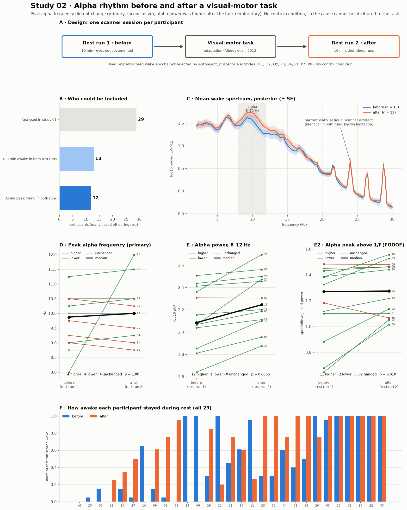

# Study 02 · Alpha rhythm before and after a visual-motor task

**Question.** In OpenNeuro ds003768, each session has two 10-minute resting-state runs, the first before and the second after a visual-motor adaptation task (dataset README; task from Albouy et al., 2012). Does the individual alpha frequency (IAF) differ between them? Pre-registered in [PREREGISTRATION.md](PREREGISTRATION.md) before any rest-run alpha measure was computed.

**Participants.** The study uses only the **13 qualified participants**: those who passed the quality rules of study 01 and had at least 3 minutes (6 epochs) of usable, expert-scored wake in **both** rest runs: 02, 04, 05, 08, 10, 19, 20, 21, 22, 26, 28, 30 and 33. A peak alpha frequency could be measured in both runs for 12 of them (participant 30 had no measurable peak after the task). Of the 29 participants who passed study 01's quality rules, the other 16 did not qualify because they were drowsy or asleep for most of at least one rest run (screening counts in [`results/screening.csv`](results/screening.csv)).

**Signal.** Artefact-corrected EEG (AAS-MNE arm of study 01), usable wake epochs only (not rejected by Autoreject), posterior electrodes O1, O2, Oz, P3, P4, Pz, P7, P8.

## Results

> [!IMPORTANT]
> **Primary hypothesis inconclusive.** Peak alpha frequency did not differ between the rest runs (median 9.88 Hz before, 10.00 Hz after; 4 higher, 4 lower, 4 unchanged; p = 1.0; n = 12). In exploratory analyses, **alpha power was higher after the task** (12 of 13 participants, p < 0.001; aperiodic-adjusted alpha peak power 11 of 13, p = 0.010). Because the design has no control condition, this increase cannot be attributed to the task rather than to time spent in the scanner or changes in vigilance.



Panel B shows the share of each rest run scored wake for every qualified participant. The mean spectra (panel C) show the alpha increase after the task as a raised peak between 8 and 12 Hz; the narrow peaks above 20 Hz are residual scanner artefact, identical in both runs. Each line in panels D–E2 is one participant (green higher, red lower, grey unchanged; black the median).

All medians below are computed over the participants included in each test, so the before and after columns describe the same people.

### Primary (pre-registered)

| Measure | n | Median before | Median after | Mean change [95% CI] | Higher / lower | p | Conclusion |
|---|:---:|:---:|:---:|:---:|:---:|:---:|---|
| Peak alpha frequency (Corcoran et al., 2018) | 12 | 9.88 Hz | 10.00 Hz | +0.31 Hz [−0.10, 1.02] | 4 / 4 | 1.0 | Inconclusive |

The positive mean reflects one participant (21: 8.0 → 12.0 Hz, estimated from 9 and 13 wake epochs). The other 11 changed by at most 0.25 Hz, the method's frequency resolution, and 4 did not change at all.

### Secondary (exploratory, uncorrected)

| Measure | n | Median before | Median after | Mean change [95% CI] | Higher / lower | p |
|---|:---:|:---:|:---:|:---:|:---:|:---:|
| Alpha centre of gravity (Corcoran et al., 2018) | 12 | 9.63 Hz | 9.75 Hz | +0.23 Hz [0.04, 0.42] | 7 / 2 | 0.086 |
| FOOOF alpha centre frequency (Donoghue et al., 2020) | 13 | 10.42 Hz | 10.11 Hz | −0.31 Hz [−1.26, 0.57] | 6 / 7 | 0.74 |
| **Alpha power, log10 µV², 8–12 Hz** | 13 | 2.08 | 2.24 | **+0.15 [0.09, 0.22]** | **12 / 1** | **< 0.001** |
| **FOOOF aperiodic-adjusted alpha peak power** | 13 | 1.27 | 1.28 | **+0.11 [0.04, 0.19]** | **11 / 2** | **0.010** |
| FOOOF aperiodic exponent | 13 | 1.87 | 1.84 | −0.02 [−0.12, 0.07] | 9 / 4 | 0.68 |
| Share of rest run scored wake† | 13 | 0.95 | 1.00 | +0.16 [0.02, 0.32] | 6 / 2 | 0.078 |
| Peak alpha frequency, equal epochs per run (sensitivity) | 12 | 9.88 Hz | 10.13 Hz | +0.50 Hz [−0.13, 1.33] | 4 / 5 | 0.84 |

†Deviation from the plan, which did not restrict this measure: it is reported for the qualified participants only. Across all 29 participants who passed study 01's quality rules, the median wake share was 0.50 before and 0.75 after (+0.07 [−0.12, 0.24], 14 / 9, p = 0.42).

Alpha power rose by 0.15 log units (about 1.4-fold) after the task, in 12 of 13 participants. The aperiodic-adjusted peak power also rose (11 of 13), indicating a change in the alpha rhythm itself rather than a broadband shift; its median changed little because the largest increases occurred in participants with low initial alpha (panel E2). The alpha-power result (p < 0.001) would survive Bonferroni correction across the seven secondary tests (adjusted p ≈ 0.003); the aperiodic-adjusted result would not (≈ 0.07). The alpha frequency measures showed no consistent change.

### Interpretation and limitations

- **No control condition.** Higher alpha power in the second rest run is compatible with an effect of visual-motor learning but equally with time in the scanner, adaptation to the environment or relaxation. A design with a control task or a second baseline would be needed to attribute it.
- **Vigilance.** Analyses were restricted to expert-scored wake, but alpha power is sensitive to drowsiness within wake; the rest runs were not matched for wakefulness beyond the stage labels.
- **Small sample.** Only 13 participants (12 for alpha frequency) had enough wake in both runs, because many fell asleep during rest.
- **Eyes open or closed** is not documented in the dataset.
- **Resolution.** Peak frequency is estimated on a 0.25 Hz grid, so changes smaller than this cannot be resolved.

### Corrections

An earlier version of this page reported the "median before / after" columns over all participants with a value in either run, which mixed in participants without a value in the other run (for example, peak alpha frequency 9.88 → 9.50 Hz). Medians are now computed over the participants included in each test (9.88 → 10.00 Hz). The tests, confidence intervals and counts were unaffected.

## Reproduce

```bash
python studies/02-alpha-before-after/run_alpha.py       # -> results/alpha_per_participant.csv, summary.json, screening.csv
python studies/02-alpha-before-after/figures_alpha.py   # -> results/alpha_overview.png
```

Methods code: [`src/methods/alpha.py`](../../src/methods/alpha.py); tests: [`tests/test_alpha.py`](../../tests/test_alpha.py).
