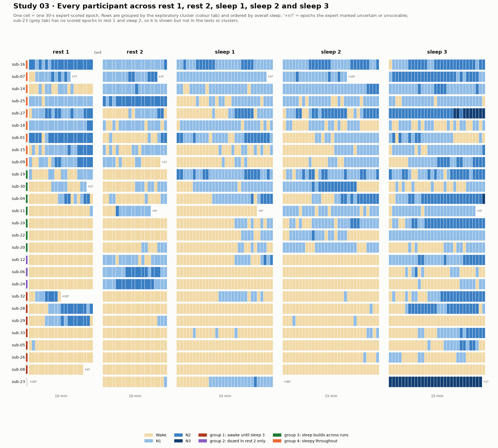
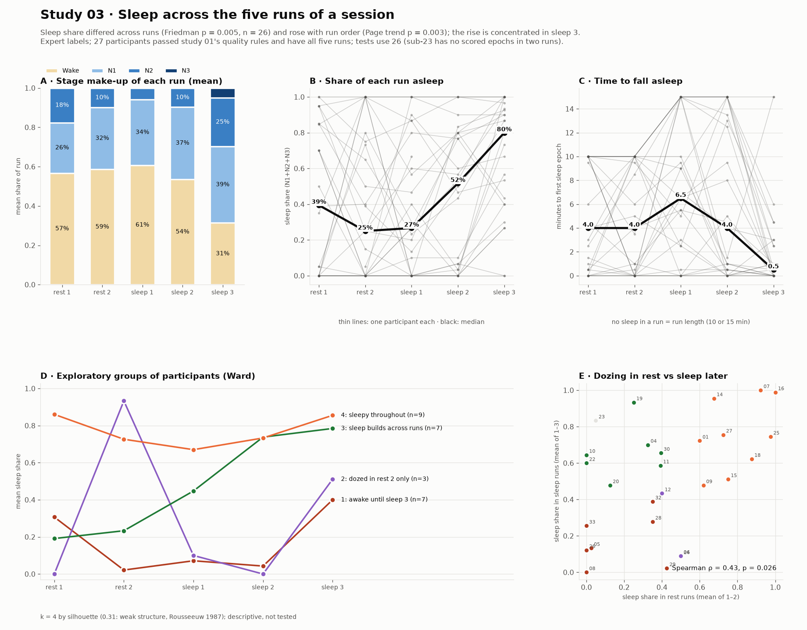

# Study 03 · Sleep across the five runs of a session

**Question.** Each ds003768 session runs in a fixed order: rest run 1 (10 min), a visual-motor adaptation task, rest run 2 (10 min), then 15-min sleep runs (dataset README). How do the amount, depth and stability of sleep change across **rest 1, rest 2, sleep 1, sleep 2 and sleep 3**, for the group and for each participant? Pre-registered in [PREREGISTRATION.md](PREREGISTRATION.md) before any per-run summary was computed. The expert labels had been seen in earlier studies (rest-run wake shares in study 02, pooled stage sequences in study 01), so the data were not unseen.

**Data.** The dataset's expert 30-s stage labels; no EEG is analysed. W, N1, N2 and N3 are kept separate; epochs the expert marked uncertain or unscorable (103 in total) are excluded from every denominator.

**Participants.** Of the 29 participants who passed study 01's quality rules, 27 have labels for all five runs (02 and 21 have no sleep runs 1–3). Participant 23 has no scored epochs in rest 1 and sleep 2, so the tests use **26**. A sensitivity analysis ignores the quality exclusions (31 with five runs, 30 tested).

## Results

> [!IMPORTANT]
> **Both pre-registered hypotheses were supported.** The share of each run spent asleep differed across the five runs (Friedman χ² = 14.9, p = 0.005, Kendall's W = 0.14) and increased with run order (Page's trend test, p = 0.003). The increase was carried by **sleep 3**: sleep share rose from sleep 2 to sleep 3 in 18 of 26 participants (Holm p = 0.011), alongside more N2 and shorter sleep-onset latency. The first sleep run had the **longest** sleep-onset latency of the session (median 6.5 min). Participants who dozed during the rest runs also slept more in the sleep runs (Spearman ρ = 0.43, p = 0.026). All results held in the sensitivity analysis. Kendall's W of 0.14 indicates that run order explains a small part of the variation; individual patterns differed widely.





### Pre-registered tests (n = 26)

| Measure | rest 1 | rest 2 | sleep 1 | sleep 2 | sleep 3 | Test | p | Holm p | Conclusion |
|---|:---:|:---:|:---:|:---:|:---:|---|:---:|:---:|---|
| **Sleep share** (H1) | 0.39 | 0.32 | 0.27 | 0.52 | 0.80 | Friedman | **0.005** | — | Differs across runs |
| **Sleep share, ordered** (H2) | | | | | | Page's L | **0.003** | — | Increases with run order |
| N2 share | 0.00 | 0.00 | 0.00 | 0.00 | 0.15 | Friedman | 0.0007 | **0.002** | Differs |
| Sleep-onset latency (min) | 4.0 | 4.0 | 6.5 | 4.0 | 0.5 | Friedman | 0.0007 | **0.002** | Differs |
| Stage shifts per hour | 15 | 14 | 24 | 16 | 24 | Friedman | 0.26 | 0.26 | No difference |

Values are medians. A run without sleep is assigned its full length as the latency (10 or 15 min).

### Where the change happens: adjacent runs (Wilcoxon, Holm within each measure)

| Pair | Sleep share: higher / lower, Holm p | N2 share: higher / lower, Holm p | Sleep-onset latency: longer / shorter, Holm p |
|---|:---:|:---:|:---:|
| rest 1 → rest 2 | 9 / 11, 1.0 | 6 / 10, 0.55 | 9 / 10, 0.84 |
| rest 2 → sleep 1 | 9 / 11, 1.0 | 6 / 6, 0.72 | 16 / 7, 0.079 |
| sleep 1 → sleep 2 | 12 / 7, 0.57 | 8 / 3, 0.30 | 8 / 12, 0.57 |
| **sleep 2 → sleep 3** | **18 / 4, 0.011** | **16 / 2, 0.010** | **5 / 19, 0.020** |

The only significant step was from sleep 2 to sleep 3: more sleep, more N2 and faster sleep onset. Nothing changed between the two rest runs or between rest 2 and sleep 1. Sleep-onset latency rose from rest 2 to sleep 1 in 16 of 23 participants with a change, but this did not survive correction (Holm p = 0.079).

### Descriptive results

- **Who slept.** Participants reaching any sleep: 17 in rest 1, 18 in rest 2, 19 in sleep 1, 21 in sleep 2 and 25 in sleep 3 (of 27).
- **Depth.** N1 was the most common sleep stage in every run. N2 reached a median of 15% only in sleep 3. N3 occurred only in sleep 3, in 3 participants (04, 23 and 27). Participant 23's sleep 3 is scored N3 in all 29 scored epochs, which is 29 of the 42 N3 epochs in the whole dataset. It follows a sleep 2 with no scorable epochs and a sleep 1 that reached N2 only briefly; this unusual record should be checked against the EEG before any N3 analysis relies on it.
- **Fragmentation.** Stage shifts did not differ across runs (median 14–24 per hour), so sleep, when present, was equally fragmented in rest and sleep runs.
- **Rest runs are not reliably "awake".** The median participant was asleep for 39% of rest 1 and 32% of rest 2, mostly N1. This matches the known drift into sleep during resting-state fMRI (Tagliazucchi & Laufs, 2014). It also explains why only 13 participants had enough wake in both rest runs for study 02.

### Per-participant patterns (exploratory)

Each participant's direction across the five runs (Spearman ρ between run order and sleep share, five points each, descriptive) was rising for 19, falling for 6 and flat for 1. Ward clustering of the five-run sleep-share profiles chose four groups (mean silhouette 0.31, which Rousseeuw (1987) classes as weak structure). They summarise the hypnograms but are not tested:

| Group | n | Participants | Pattern |
|---|:---:|---|---|
| 1 · Awake until sleep 3 | 7 | 05, 08, 26, 28, 29, 32, 33 | Mostly awake in rest 2, sleep 1 and sleep 2; some slept in sleep 3 (mean 40%). Four (28, 29, 32 and, briefly, 05) dozed in rest 1, then stayed awake after the task. |
| 2 · Dozed in rest 2 only | 3 | 06, 12, 24 | Awake in rest 1, asleep (N1–N2) in nearly all of rest 2, awake in sleep 1–2, partly asleep in sleep 3. |
| 3 · Sleep builds across runs | 7 | 04, 10, 11, 19, 20, 22, 30 | Mostly awake in the rest runs; sleep increased run by run to a mean of 78% in sleep 3. The pattern the group test describes. |
| 4 · Sleepy throughout | 9 | 01, 07, 09, 14, 15, 16, 18, 25, 27 | Asleep for most of every run (mean 67–86%), including rest 1, often reaching N2 before the task. |

Groups 1 and 4 explain the falling trajectories: the six falling participants (01, 16, 18, 25, 29 and 09) all slept heavily in rest 1.

### Interpretation and limitations

- **Sleep 3, not the switch to "sleep" runs, carries the increase.** The instruction change between rest 2 and sleep 1 was not followed by more sleep. Sleep onset was, if anything, slower in sleep 1, perhaps because of the break between scans, but the dataset does not document what happened between runs. The rise in sleep 3 is consistent with accumulating time in the scanner (Tagliazucchi & Laufs, 2014).
- **Order is confounded with time.** The run order is fixed, so run type, time of day and time in the scanner cannot be separated.
- **Rest-run sleep is a trait-like tendency.** People who slept during rest also slept more later (ρ = 0.43). Rest runs are therefore a poor "awake baseline" for a sizeable minority: in group 4, the pre-task rest run was mostly sleep.
- **Small effect, large individual differences.** Kendall's W = 0.14. The group trend is real but describes only some people: group 3 follows it closely, groups 1 and 2 do not.
- **Expert labels only.** All measures depend on the single expert scoring; 103 epochs were marked uncertain or unscorable.
- **Prior exposure.** The labels had been seen before; the tests were specified before computing these summaries, but this is not a blind analysis.

### Sensitivity: quality exclusions ignored (n = 30)

H1 Friedman p = 0.015 (W = 0.10); H2 Page p = 0.017; N2 share Holm p = 0.002; sleep-onset latency Holm p = 0.007; stage shifts Holm p = 0.37. Sleep 2 → sleep 3 remained the only significant adjacent step (sleep share Holm p = 0.012). Rest-vs-sleep correlation: ρ = 0.48, p = 0.007. All conclusions are unchanged.

## Reproduce

```bash
python studies/03-run-architecture/run_architecture.py          # -> results/per_run.csv, summary.json
python studies/03-run-architecture/run_architecture.py --all    # -> results/sensitivity_all/
python studies/03-run-architecture/figures_architecture.py      # -> results/hypnograms.png, run_overview.png
```

## References

- Berry, R. B., et al. *The AASM Manual for the Scoring of Sleep and Associated Events*. American Academy of Sleep Medicine.
- Friedman, M. (1937). The use of ranks to avoid the assumption of normality implicit in the analysis of variance. *Journal of the American Statistical Association*, 32(200), 675–701. https://doi.org/10.1080/01621459.1937.10503522
- Holm, S. (1979). A simple sequentially rejective multiple test procedure. *Scandinavian Journal of Statistics*, 6(2), 65–70.
- Kendall, M. G., & Babington Smith, B. (1939). The problem of *m* rankings. *The Annals of Mathematical Statistics*, 10(3), 275–287. https://doi.org/10.1214/aoms/1177732186
- Page, E. B. (1963). Ordered hypotheses for multiple treatments: a significance test for linear ranks. *Journal of the American Statistical Association*, 58(301), 216–230. https://doi.org/10.1080/01621459.1963.10500843
- Rousseeuw, P. J. (1987). Silhouettes: a graphical aid to the interpretation and validation of cluster analysis. *Journal of Computational and Applied Mathematics*, 20, 53–65. https://doi.org/10.1016/0377-0427(87)90125-7
- Spearman, C. (1904). The proof and measurement of association between two things. *The American Journal of Psychology*, 15(1), 72–101. https://doi.org/10.2307/1412159
- Tagliazucchi, E., & Laufs, H. (2014). Decoding wakefulness levels from typical fMRI resting-state data reveals reliable drifts between wakefulness and sleep. *Neuron*, 82(3), 695–708. https://doi.org/10.1016/j.neuron.2014.03.020
- Ward, J. H. (1963). Hierarchical grouping to optimize an objective function. *Journal of the American Statistical Association*, 58(301), 236–244. https://doi.org/10.1080/01621459.1963.10500845
- Wilcoxon, F. (1945). Individual comparisons by ranking methods. *Biometrics Bulletin*, 1(6), 80–83. https://doi.org/10.2307/3001968
