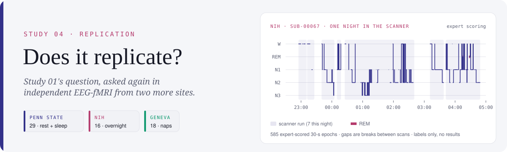
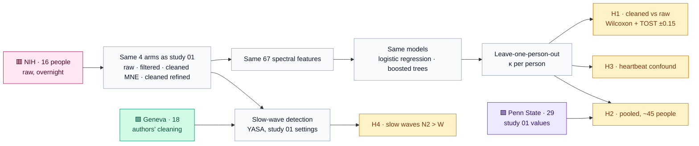

<picture>
  <source media="(prefers-color-scheme: dark)" srcset="assets/banner-dark.svg">
  
</picture>

<p align="center">
  
  
  
  <a href="PREREGISTRATION.md"></a>
  
</p>

<p align="center">
  <a href="#-the-question">Question</a> ·
  <a href="#%EF%B8%8F-sites">Sites</a> ·
  <a href="#-design">Design</a> ·
  <a href="#-hypotheses">Hypotheses</a> ·
  <a href="#-progress">Progress</a> ·
  <a href="#-pilot">Pilot</a> ·
  <a href="#-amendments">Amendments</a> ·
  <a href="#%EF%B8%8F-limitations">Limitations</a> ·
  <a href="#%EF%B8%8F-reproduce">Reproduce</a>
</p>

## ❓ The question

[Study 01](../01-preprocessing-ablation) found that removing scanner and heartbeat artefacts from in-scanner EEG **did not significantly improve automated sleep staging** (Δκ = 0.056, 95% CI [−0.020, 0.137]), but that **without it, the classifier partly read the heartbeat instead of the brain** (p = 0.0007). Both findings come from one site, one scanner and one team of scorers.

**Do they hold in independent data, and if cleaning does not help, is its effect small enough to call negligible?**

> [!NOTE]
> No classifier has been trained and no hypothesis tested yet. By the pre-registration, that happens only once every participant is processed. Everything on this page so far is processing quality.

## 🗺️ Sites

| | Dataset | Site | People | Recording | EEG available | Expert labels | Role |
|:---:|---|---|:---:|---|---|---|---|
| 🟪 | [ds003768](https://openneuro.org/datasets/ds003768) | Penn State | 29 analysed | rest + sleep runs, 32 ch, 5 kHz | raw | 30-s epochs | study 01, already reported |
| 🟥 | [ds005127](https://openneuro.org/datasets/ds005127) · Moehlman et al., 2019 | NIH (NINDS) | 16 | **overnight**, 63 EEG + ECG + EMG, 5 kHz, TR 3 s | raw | AASM, 30-s epochs, W/N1/N2/N3/REM | independent replication (H1, H3, H4) |
| 🟩 | [ds003574](https://openneuro.org/datasets/ds003574) · Sterpenich et al., 2021 | Geneva | 18 | nap of 1–2 h, 64 ch, 500 Hz, TR 2.1 s | cleaned only | per fMRI volume, rebuilt into 30-s epochs | slow-wave validity (H4) |

The banner shows one NIH night as the expert scored it: seven scanner runs between 22:55 and 04:50, the gaps being breaks between scans.

## 🧭 Design



Methods are identical to study 01 unless the [pre-registration](PREREGISTRATION.md#methods-identical-to-study-01-unless-stated) says otherwise. The differences are practical: NIH recordings are processed one channel and one run at a time (a run is 30 min to 2.5 h of 65 channels at 5 kHz), and only epochs scored with the scanner running for the whole 30 s are used.

## 🎯 Hypotheses

Registered on **27 Oct 2026, 13:45 IST**, before any EEG from the new datasets was processed.

| | Hypothesis | Test | Role |
|:---:|---|---|---|
| **H1** | In NIH data, cleaning (MNE) gives higher per-person κ than raw | two-sided Wilcoxon signed-rank, α = 0.05; mean Δκ with bootstrap 95% CI | **primary, confirmatory** |
| **H1-eq** | …or the difference is negligible | TOST (Lakens, 2017), bounds ±0.15 κ | outcome: improvement, negligible, or inconclusive |
| **H2** | The same contrast, Penn State + NIH pooled | Wilcoxon + TOST ±0.15 | better powered, but not blind (study 01 is known) |
| **H3** | Without cleaning, predictions follow heart rate within expert stage | Spearman per person, Wilcoxon against 0 | replicates study 01 amendment 5 |
| **H4** | Slow-wave density is higher in N2 than in wake | Wilcoxon, NIH and Geneva (cleaned) | replicates study 01's detector validity |

**Power, stated in advance.** With 15–16 NIH participants, H1 has 80% power only for differences of about 0.15 κ or more. TOST at ±0.15 needs about 40 participants, so H1-equivalence will probably be inconclusive on NIH alone; H2 (about 45 people) is the better-powered test.

## 📈 Progress

<p>
  
  
</p>

| Stage | Status |
|---|---|
| 1 · Pre-registration | ✅ 27 Oct 2026, 13:45 IST |
| 2 · Pilot (2 NIH participants, processing quality only) | ✅ done |
| 3 · Fault found by the pilot: fixed and verified | ✅ [amendment 2](PREREGISTRATION.md#amendment-2--scanner-artefact-template-length) |
| 4 · NIH processing, one participant at a time | 🟠 running (the badges above update as participants finish) |
| 5 · Geneva processing (loader for the authors' cleaned EEG) | ⚪ not started |
| 6 · Classifiers and hypothesis tests | 🔒 locked until stages 4 and 5 are complete |

## 🧪 Pilot

The pilot ran two NIH participants end to end to check trigger and label alignment, memory, disk use and cleaning quality. **Only processing outputs were looked at.** Both participants stay in the final sample.

| | sub-00002 | sub-00067 |
|---|:---:|:---:|
| Runs usable | 1 of 2 (run 2: all 113 epochs unscorable, skipped by rule 1) | 7 of 7 |
| Epochs analysed (W / N1 / N2) | 49 (17 / 26 / 6) | 366 (57 / 150 / 159) |
| Epochs rejected (Autoreject) | 6.1% | 19.4% |
| Bad channels, median (max) | 4 (4) | 0 (1) |
| Heart rate, median | 59 bpm | 57 bpm |
| Heartbeat removal, INPS (MNE detector) | 3.9 dB | 0.7 dB (runs 0.4–2.1) |
| Exclusion rules 4 and 5 | pass | pass |

### A fault the pilot caught

> [!IMPORTANT]
> **Heartbeat removal looked weak in sub-00067, but the cause was upstream.** Two of its runs contain a few irregular scanner triggers (2-s gaps among thousands of 3-s ones). The scanner-artefact template was set to the *shortest* gap, so it covered only 2 s of each 3-s volume. The last second of every volume stayed uncorrected, and the heartbeat detectors locked onto those bursts.
>
> **Fix:** the template is now one full TR (the median gap), as average artefact subtraction defines it (Allen et al., 2000), backed by a regression test. All 255 Penn State recordings have perfectly regular triggers, so **studies 01–03 are unaffected**.

sub-00067 was re-processed with the fix:

| sub-00067, runs with irregular triggers | Run 5 before | Run 5 after | Run 7 before | Run 7 after |
|---|:---:|:---:|:---:|:---:|
| Heartbeat-locked residual in cleaned EEG | 954 µV | **6.2 µV** | 256 µV | **4.2 µV** |
| … relative to a random-locked average | ×28 | **×2.2** | ×12 | **×2.7** |
| Beats double-counted (MNE detector) | 31% | **0.3%** | 14% | **0.3%** |
| Heart rate (MNE detector) | 68 bpm | **57 bpm** | 91 bpm | **52 bpm** |

Both runs now look like the participant's other runs (residual ×0.8–2.4 random). INPS stays modest in every sub-00067 run, including runs that never had the fault: this person's pulse artefact is small to begin with (2.6 µV in run 3), so there is little to remove.


<sub>Left: 10 s of ECG with detected beats. Middle: beat-to-beat interval across the run. Right: average scalp EEG locked to each beat, after cleaning.</sub>

## 📝 Amendments

| # | Added | What changed | Effect |
|:---:|---|---|---|
| [1](PREREGISTRATION.md#amendment-1--pilot-findings) | 27 Oct 2026, 16:38 IST | Pilot findings; processing fixes (status file, raw-file deletion, prefetching, progress counting) | none: no method changed |
| [2](PREREGISTRATION.md#amendment-2--scanner-artefact-template-length) | 27 Oct 2026, 16:45 IST | Scanner-artefact template is one TR long (median trigger interval) | applied to every participant before the full run; studies 01–03 unaffected |

Both amendments were registered before any classifier was trained or any hypothesis tested.

## ⚠️ Limitations

- **Small NIH sample.** 16 people can detect only large effects, so a non-significant H1 on its own will not mean "no effect".
- **H2 is not blind.** Penn State's values were already reported in study 01; H1 is the confirmatory test.
- **Geneva is cleaned only.** It cannot test raw vs cleaned, only whether slow-wave detection behaves in another lab's cleaned data.
- **Different montages.** NIH has no F7/F8, and eye channels differ between sites, so cross-site analyses use EEG features only.
- **Geneva labels are per fMRI volume.** The original 30-s epochs are rebuilt from them, and epochs whose volumes disagree are excluded.

## ▶️ Reproduce

<details>
<summary><b>Commands</b></summary>

```bash
python studies/04-multisite-replication/build_nih.py --subjects 00002 00067 --budget-min 60   # download, 4 arms, QC, features; deletes raw after each run
python studies/04-multisite-replication/pilot_heartbeat_check.py                              # heartbeat check -> results/
python studies/04-multisite-replication/make_banner.py                                        # this page's banner, from the expert labels
```
</details>

[`build_nih.py`](build_nih.py) applies study 01's arms, cleaning, features and quality rules to ds005127. It downloads each run, processes it one channel at a time and deletes it afterwards, so only one or two runs are on disk at any time.

## 📚 References

- Allen, P. J., Josephs, O., & Turner, R. (2000). A method for removing imaging artifact from continuous EEG recorded during functional MRI. *NeuroImage*, 12(2), 230–239. https://doi.org/10.1006/nimg.2000.0599
- Lakens, D. (2017). Equivalence tests: a practical primer for *t* tests, correlations, and meta-analyses. *Social Psychological and Personality Science*, 8(4), 355–362. https://doi.org/10.1177/1948550617697177
- Moehlman, T. M., de Zwart, J. A., Chappel-Farley, M. G., Liu, X., et al. (2019). All-night functional magnetic resonance imaging sleep studies. *Journal of Neuroscience Methods*, 316, 83–98. https://doi.org/10.1016/j.jneumeth.2018.09.019
- Sterpenich, V., van Schie, M. K. M., Catsiyannis, M., et al. (2021). Reward biases spontaneous neural reactivation during sleep. *Nature Communications*, 12, 4162. https://doi.org/10.1038/s41467-021-24357-5
- Study 01 methods and their references: [`../01-preprocessing-ablation/PREREGISTRATION.md`](../01-preprocessing-ablation/PREREGISTRATION.md)

---

<sub>Bhagyashree Besra · ORCID <a href="https://orcid.org/0009-0008-6118-7602">https://orcid.org/0009-0008-6118-7602</a> · part of <a href="../../README.md">sleep-eeg-fmri</a></sub>
