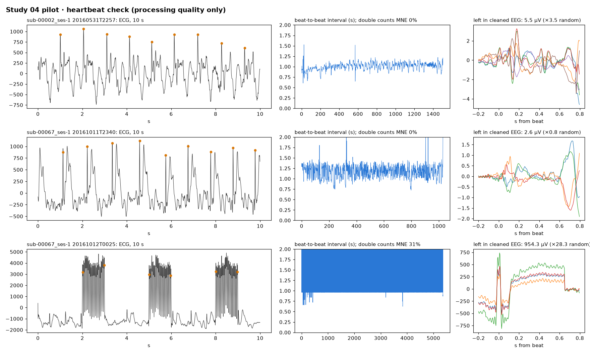

# Study 04 · Multi-site replication

**Question.** Do study 01's findings hold in independent simultaneous EEG-fMRI sleep data from other sites, scanners and scorers? Pre-registered in [PREREGISTRATION.md](PREREGISTRATION.md) before any new EEG was processed.

| Dataset | Site | Participants | Recording | Role |
|---|---|:---:|---|---|
| [ds003768](https://openneuro.org/datasets/ds003768) | Penn State | 29 analysed | rest + naps, 32 ch | study 01 (already reported) |
| [ds005127](https://openneuro.org/datasets/ds005127) (Moehlman et al., 2019) | NIH | 16 | overnight, 63 ch, raw | independent replication (H1) |
| [ds003574](https://openneuro.org/datasets/ds003574) (Sterpenich et al., 2021) | Geneva | 18 | nap, 64 ch, cleaned only | slow-wave validity, cross-site |

## Status

**Pilot complete; one processing fault found and fixed ([amendment 2](PREREGISTRATION.md#amendment-2--scanner-artefact-template-length)); sub-00067 is being re-processed before the full run.** No classifier has been trained and no hypothesis tested yet: that happens only when the full sample is processed.

### Pilot (processing quality only)

| | sub-00002 | sub-00067 |
|---|:---:|:---:|
| Runs usable | 1 of 2 (run 2: all epochs unscorable, skipped by rule 1) | 7 of 7 |
| Epochs analysed (W / N1 / N2) | 49 (17 / 26 / 6) | 366 (57 / 150 / 159) |
| Epochs rejected (Autoreject) | 6.1% | 16.9% |
| Bad channels, median (max) | 4 (4) | 0 (2) |
| Heart rate, median | 59 bpm | 68 bpm |
| Heartbeat removal, INPS (MNE detector) | **3.9 dB** | **0.7 dB** (run 5: −0.9 dB) |
| Exclusion rules 4 and 5 | pass | pass |

Heartbeat removal looked weak in sub-00067. The cause was upstream: two of its runs contain a few irregular scanner triggers, and the scanner-artefact template was set to the shortest trigger interval (2 s instead of the 3-s TR), leaving the last second of every volume uncorrected; the beat detectors then locked onto those bursts. The template is now one TR long, as the method defines ([amendment 2](PREREGISTRATION.md#amendment-2--scanner-artefact-template-length)); ds003768 has no irregular triggers, so studies 01–03 are unaffected.



## Code

[`build_nih.py`](build_nih.py) applies study 01's arms, cleaning, features and quality rules to ds005127, one channel and one run at a time (each run is 30 min to 2.5 h of 65 channels at 5 kHz), downloading each run and deleting it after use.

```bash
python studies/04-multisite-replication/build_nih.py --subjects 00002 00067 --budget-min 60
```

## References

- Moehlman, T. M., de Zwart, J. A., Chappel-Farley, M. G., Liu, X., et al. (2019). All-night functional magnetic resonance imaging sleep studies. *Journal of Neuroscience Methods*, 316, 83–98. https://doi.org/10.1016/j.jneumeth.2018.09.019
- Sterpenich, V., van Schie, M. K. M., Catsiyannis, M., et al. (2021). Reward biases spontaneous neural reactivation during sleep. *Nature Communications*, 12, 4162. https://doi.org/10.1038/s41467-021-24357-5
